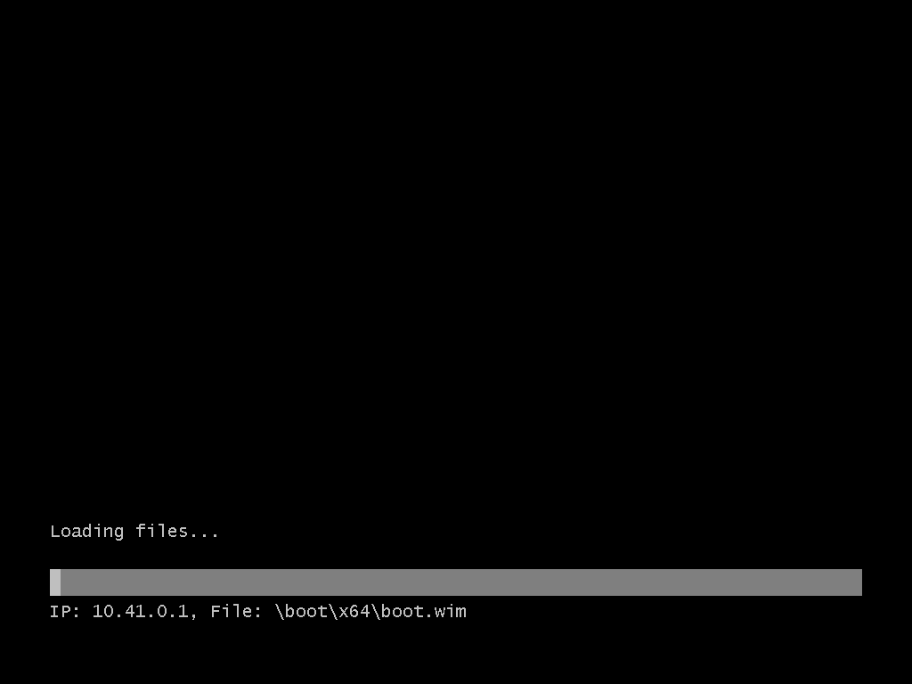
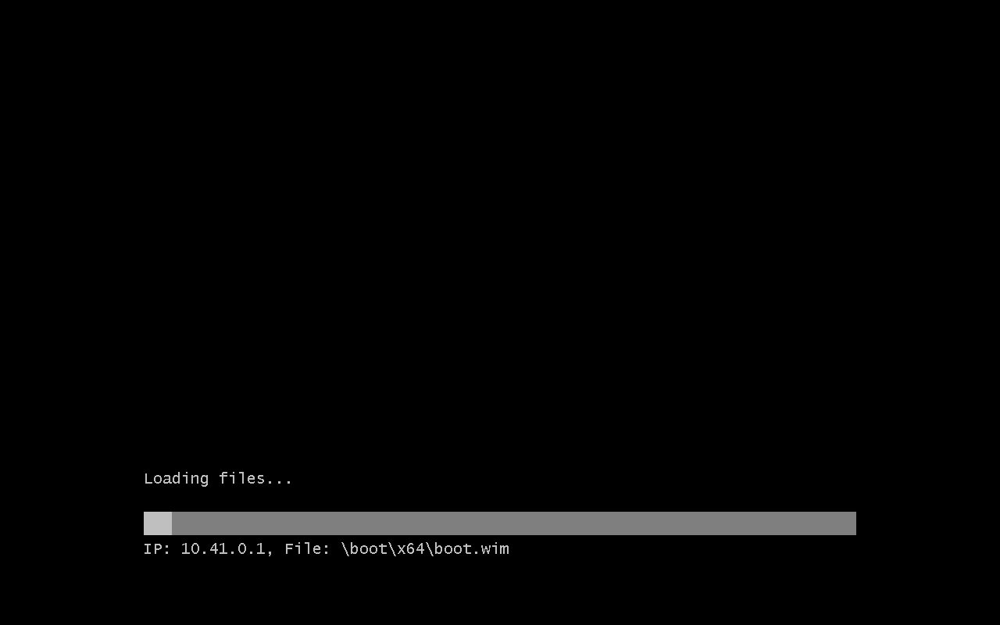

# Boot fonts for each boot manager in the PXE lab

This page records whether each boot manager boots with the other set of boot fonts at `\boot\fonts`, for [#222](https://github.com/Tsukidy/deployarr/issues/222). The `bios` VM gets the `Fonts_EX` set beside the 2011-signed `bootmgr.exe`. The `uefi2023` VM gets the `Fonts` set beside the 2023-signed `bootmgfw.efi`. Each run has a control on the same VM with the set that the lab served it before. The runs are from 2026-11-18, on the lab host. A follow-up applies the results to the architecture.

## Result

| VM | Boot manager | Font set at `boot/fonts` | Font requests | `Loading files...` text | WinPE |
| --- | --- | --- | --- | --- | --- |
| `bios`, run 1 | `pxeboot.n12`, then the 2011-signed `bootmgr.exe` | `Fonts_EX` | `\boot\fonts\wgl4_boot.ttf` only, 50120 bytes | Same pixels as the control | Starts |
| `bios`, control | `pxeboot.n12`, then the 2011-signed `bootmgr.exe` | `Fonts` | `\boot\fonts\wgl4_boot.ttf` only, 50096 bytes | Control | Starts |
| `uefi2023`, run 2 | The 2023-signed `bootmgfw.efi` | `Fonts` | `\boot\fonts\wgl4_boot.ttf` only, 50096 bytes | Same pixels as the control | Starts |
| `uefi2023`, control | The 2023-signed `bootmgfw.efi` | `Fonts_EX` | `\boot\fonts\wgl4_boot.ttf` only, 50120 bytes | Control | Starts |

- Both runs started WinPE with the other font set. The last screendump of each run shows WinPE's `cmd.exe` window after `wpeinit`, as in its control.
- In both runs, the text of the `Loading files...` screen matches the control's pixel for pixel. The whole first frame of each run's `boot.wim` window, as [Screens](#screens) defines it, is the same file as its control's.
- Each boot manager requested one font, `\boot\fonts\wgl4_boot.ttf`, and no other file from `boot/fonts`.
- Each run made the same TFTP requests as its control, file for file and option for option.
- So one font folder can serve both firmware types. The folder would hold the `Fonts` set, as the owner chose for this result ([Owner input on #222](https://github.com/Tsukidy/deployarr/issues/222#issuecomment-6990303505)).

## The two font sets

The lab's TFTP roots hold the two sets from the boot image. `tools/lab/media.sh` builds the roots in [step 6 of the lab guide](../../lab-setup.md#6-get-the-windows-files). It fills `~/deployarr-lab/tftp/2011` from `Windows\Boot\Fonts` (line 86) and `~/deployarr-lab/tftp/2023` from `Windows\Boot\Fonts_EX` (line 88). It removes `_EX` from each font's name as it copies the font (line 72). [Where the 2023-signed programs come from](uefi-ca-2023.md#where-the-2023-signed-programs-come-from) also records that the `2023` root has the `Fonts_EX` fonts. The two roots list the same 31 files. Exactly 18 of them differ: the 16 fonts in `boot/fonts`, `boot/x64/bootmgfw.efi`, and `boot/x64/wdsmgfw.efi`. `pxeboot.n12`, `bootmgr.exe`, the BCD stores, `boot.sdi`, and `boot.wim` are the same files in both.

- Neither `bios` run requested `bootmgfw.efi` or `wdsmgfw.efi`. So run 1 differs from the `bios` control only in `boot/fonts`.
- `bootmgr.exe` is signed through the Microsoft Windows Production PCA 2011. `pxeboot.n12` is not a PE file and carries no signature, and it is the same file in both roots.
- Run 2's root links every file to the `2023` root except `boot/fonts`, which it links to the `2011` root. So run 2 differs from the `uefi2023` control only in `boot/fonts`.

Both `wgl4_boot.ttf` files are TrueType fonts, `sfnt` version `0x00010000`, with 13 tables. Only two tables differ.

| Table | Bytes in `Fonts` | Bytes in `Fonts_EX` | Same bytes |
| --- | --- | --- | --- |
| `DSIG` | 9656 | 9680 | No |
| `head` | 54 | 54 | No. Only bytes 8 to 11 differ, which hold `checkSumAdjustment`. |
| `EBDT` | 24141 | 24141 | Yes |
| `EBLC` | 2836 | 2836 | Yes |
| `OS/2` | 96 | 96 | Yes |
| `cmap` | 1612 | 1612 | Yes |
| `glyf` | 68 | 68 | Yes |
| `hhea` | 36 | 36 | Yes |
| `hmtx` | 2668 | 2668 | Yes |
| `loca` | 1336 | 1336 | Yes |
| `maxp` | 32 | 32 | Yes |
| `name` | 639 | 639 | Yes |
| `post` | 6693 | 6693 | Yes |

So the two files hold the same glyphs, bitmaps, and metrics. They differ in the signature block and in the checksum of the whole file.

Each `DSIG` table has version 1 and one signature, in format 1. Its PKCS#7 block is 9628 bytes in `Fonts` and 9650 bytes in `Fonts_EX`. Both blocks name the same signer:

- Subject `CN=Microsoft Windows`, `O=Microsoft Corporation`
- Issuer `CN=Microsoft Windows Production PCA 2011`
- Serial `0x3300000518418419ADCBAD294F000000000518`

Each block also holds the certificate of the Microsoft Windows Production PCA 2011, issued by the Microsoft Root Certificate Authority 2010, with serial 458207203049816025202696. The signer's serial is the one that the `issuer_and_serial` field of the signer info names.

These commands read the tables and the signer. The first Python script prints each table's tag, length, and SHA-256 for both files, and the bytes of `head` that differ. The second writes the PKCS#7 block of signature record 0 for one file to a temporary file from `mktemp`, outside the checkout. `openssl` reads that file, and the last line deletes it. The second script also prints the `DSIG` version, signature count, and flags, then record 0's format, length, offset, and PKCS#7 size, on standard error.

```bash
python3 -I - ~/deployarr-lab/tftp/2011/boot/fonts/wgl4_boot.ttf ~/deployarr-lab/tftp/2023/boot/fonts/wgl4_boot.ttf <<'EOF'
import hashlib, struct, sys
heads = []
for path in sys.argv[1:]:
    data = open(path, "rb").read()
    count = struct.unpack(">H", data[4:6])[0]
    for i in range(count):
        tag, _, off, length = struct.unpack(">4sIII", data[12 + 16 * i:28 + 16 * i])
        print(path, tag.decode(), length, hashlib.sha256(data[off:off + length]).hexdigest())
        if tag == b"head":
            heads.append(data[off:off + length])
print("head bytes that differ", [i for i in range(54) if heads[0][i] != heads[1][i]])
EOF
P=$(mktemp)
python3 -I - ~/deployarr-lab/tftp/2011/boot/fonts/wgl4_boot.ttf > "$P" <<'EOF'
import struct, sys
data = open(sys.argv[1], "rb").read()
count = struct.unpack(">H", data[4:6])[0]
for i in range(count):
    tag, _, off, length = struct.unpack(">4sIII", data[12 + 16 * i:28 + 16 * i])
    if tag == b"DSIG":
        table = data[off:off + length]
        version, sigs, flags, fmt, rec_len, rec_off = struct.unpack(">IHHIII", table[:20])
        block = table[rec_off:rec_off + rec_len]
        size = struct.unpack(">I", block[4:8])[0]
        print(version, sigs, flags, fmt, rec_len, rec_off, size, file=sys.stderr)
        sys.stdout.buffer.write(block[8:8 + size])
EOF
openssl pkcs7 -inform DER -print_certs -noout < "$P"
openssl pkcs7 -inform DER -print -noout < "$P" | grep -E 'serialNumber|^ *serial:'
rm -f "$P"
```

The second script and the lines after it run once more with the `2023` file. `openssl` is 3.5.5. The `grep` prints three lines: the serial of each certificate, and then the signer info's serial.

## Setup

| Item | Value |
| --- | --- |
| Lab host | Ubuntu 26.04.1 LTS, kernel `7.0.0-43-generic`, AMD Ryzen 7 7700X, KVM. The host restarted between the `uefi2023` control and run 2. |
| Lab scripts and PXE prototype | `tools/lab/` and `tools/pxe-prototype/` from `main` at `3fc0d3f`. Both changed after the #27 and #32 runs. Among the changes, dnsmasq moved into its own network namespace. So the controls ran again on this page. |
| Network | `br-lab` at `10.41.0.1/24`. dnsmasq, at `10.41.0.2` in the namespace `deployarr-lab-dhcp`, hands out `10.41.0.100` to `10.41.0.199`, as [step 4 of the lab guide](../../lab-setup.md#4-start-the-lab-network) says. The prototype answers PXE on ports 67 and 4011. |
| Chain | `--chain single`, with the default stores `boot\uefi.bcd` and `boot\bios.bcd` |
| TFTP roots | `~/deployarr-lab/tftp/2011` for the `bios` control, and `~/deployarr-lab/tftp/2023` for run 1 and the `uefi2023` control. Run 2 used `~/deployarr-lab/runs/222/tftp-2023-fonts-2011`, which [Run 2's TFTP root](#run-2s-tftp-root) describes. |
| `uefi2023` VM | `q35` with SMM, OVMF `OVMF_CODE_4M.ms.fd`, a fresh copy of `~/deployarr-lab/OVMF_VARS_4M.win23.fd`, Secure Boot on, TPM 2.0 through swtpm, a virtio-net card with no option ROM, MAC `52:54:00:41:00:12`, 2 vCPUs, 4 GB. Its `db` holds only the Windows UEFI CA 2023. |
| `bios` VM | `pc` with `smbios-entry-point-type=32`, SeaBIOS, QEMU's `e1000` card with its iPXE ROM, MAC `52:54:00:41:00:21`, 2 vCPUs, 4 GB |

The prototype's `started` line is the same in all four runs except for its root. On `bios`, each ACK named `boot\x64\pxeboot.n12` and option 252 = `boot\bios.bcd`. On `uefi2023`, each ACK named `boot\x64\bootmgfw.efi` and option 252 = `boot\uefi.bcd`.

| Run | VM start | Last screendump |
| --- | --- | --- |
| `bios` control | 20:28:05.429 | 20:30:15.886 |
| Run 1 | 20:30:39.814 | 20:32:50.244 |
| `uefi2023` control | 20:33:13.588 | 20:34:43.514 |
| Run 2 | 20:58:56.413 | 21:00:28.393 |

The run script deleted the VM's folder under `~/deployarr-lab` before each run. So each run's disk was new, and on `uefi2023` its firmware variables and TPM state were new too. The `bios` VM has no variable store or TPM. After each run, and before the next one, the lab stage recorded `stat -c '%w %y %s %n'` of every file in that folder in `~/deployarr-lab/runs/222/boot-fonts-<run>-vmstate.txt`. Every file was born after that run's VM start.

The lab host shut down at about 20:36 UTC, about a minute into the first try of run 2. It booted again at 20:40:58 UTC. The owner says the shutdown should not be related to the runs. The first try's files are set aside in `~/deployarr-lab/runs/222/interrupted-20261118T2035Z/`, and this page does not use them. Run 2 then ran again, from a fresh VM folder, at 20:58:56. So run 2 ran after the restart, and its control ran before it. The `bios` control, run 1, and the `uefi2023` control all finished before the shutdown.

The run script wrote the wall clock and `/proc/uptime` at each step. Within each run, wall clock minus uptime stays within 0.01 seconds, the resolution of `/proc/uptime`. That difference puts the host's start at 2026-11-17 20:55:20 UTC for the first three runs, and at 2026-11-18 20:40:58 UTC for run 2. After the restart, `tools/lab/network.sh status` differed from its earlier output only in dnsmasq's process ID.

### Run 2's TFTP root

Run 2's root sits outside the repository, at `~/deployarr-lab/runs/222/tftp-2023-fonts-2011`. It is a copy of the `2023` root made of hard links, with `boot/fonts` replaced by links to the `2011` set. No file in it was edited in place. These commands built it and checked it at 20:27 UTC, before the runs:

```bash
T=/home/user/deployarr-lab/tftp; X=/home/user/deployarr-lab/runs/222/tftp-2023-fonts-2011; test ! -e "$X" && cp -al "$T/2023" "$X" && rm -r "$X/boot/fonts" && cp -al "$T/2011/boot/fonts" "$X/boot/fonts" && echo built
T=/home/user/deployarr-lab/tftp; X=/home/user/deployarr-lab/runs/222/tftp-2023-fonts-2011; find "$X" -type f -printf '%P\n' | sort | while read -r p; do case $p in boot/fonts/*) s=$T/2011/$p ;; *) s=$T/2023/$p ;; esac; if [ "$(stat -c %i "$X/$p")" = "$(stat -c %i "$s")" ]; then echo "link $p $s"; else echo "NOT-A-LINK $p"; fi; done > /home/user/deployarr-lab/runs/222/tftp-2023-fonts-2011-links.txt; grep -c NOT-A-LINK /home/user/deployarr-lab/runs/222/tftp-2023-fonts-2011-links.txt; wc -l < /home/user/deployarr-lab/runs/222/tftp-2023-fonts-2011-links.txt
diff <(find /home/user/deployarr-lab/tftp/2023 -printf '%P\n' | sort) <(find /home/user/deployarr-lab/runs/222/tftp-2023-fonts-2011 -printf '%P\n' | sort) && echo same-tree
X=/home/user/deployarr-lab/runs/222/tftp-2023-fonts-2011; find "$X" -type f ! -name boot.wim -printf '%P\n' | sort | while read -r p; do printf '%s %s %s\n' "$(sha256sum < "$X/$p" | cut -c1-64)" "$(stat -c %s "$X/$p")" "$p"; done > /home/user/deployarr-lab/runs/222/tftp-2023-fonts-2011-sha256.txt; grep -E ' boot/(fonts/wgl4_boot.ttf|x64/bootmgfw.efi|uefi.bcd)$' /home/user/deployarr-lab/runs/222/tftp-2023-fonts-2011-sha256.txt
```

- The first command printed `built`.
- The link check found 31 files and 0 `NOT-A-LINK` lines. The 16 fonts link to the `2011` root, and the other 15 files link to the `2023` root.
- The third command printed `same-tree`.
- The hash list gives `boot/fonts/wgl4_boot.ttf` 50096 bytes, `23872d2eba60bbb3bd2585e925c4b48769fb6bb0cfa7f4a6ba4e8f03bcaf2c35`, `boot/x64/bootmgfw.efi` 3087200 bytes, `25d8869e3c79083ae62c698a9db9030748e3267bd53593357447f3f72761d1f2`, and `boot/uefi.bcd` 12288 bytes, `c0164082153aa4eeb826b68d9e3acb4ad815fbf64b8dc1b8a51ef0f02d010224`.

After the restart, the link check and the hash list ran again, into new files. Their output is byte for byte the same as before. The root was not rebuilt.

## Versions

The component versions and firmware files are the same as in [Versions](bootmgr-object-type.md#versions) of the `{bootmgr}` object type page. The lab host recorded them before the first run and again after the restart, and the two records differ only in the time and the uptime. Neither record lists `libhivex-bin`, so this page does not give its version. The `uefi2023` VM's variable store, `~/deployarr-lab/OVMF_VARS_4M.win23.fd`, has the SHA-256 `16b2478518659d692b85cd6e400b23a28f924ec95a63da86e904d8e4792462d3`.

These are the boot managers and fonts that the runs served. Each size and SHA-256 comes from the path that the prototype logged for a complete transfer. The issuer is the `Issuer :` line under `Signer's certificate:` in the output of `osslsigncode verify`. The version is the file version in each file's version resource.

| File | Served in | Bytes | SHA-256 | Issuer | Version |
| --- | --- | --- | --- | --- | --- |
| `boot/x64/pxeboot.n12` | Both `bios` runs | 25238 | `9e34cbc08fc26902f351889b8c29c80b5f6ec99f1bb44dcf083ba2b988e37267` | Not a PE file | None |
| `boot/x64/bootmgr.exe` | Both `bios` runs | 814544 | `364c896a4fd4690949d1f7c386332f4f32541b01a05adfc13b7178258571a7ad` | Microsoft Windows Production PCA 2011 | 10.0.26100.9444 |
| `2023/boot/x64/bootmgfw.efi` | Both `uefi2023` runs | 3087200 | `25d8869e3c79083ae62c698a9db9030748e3267bd53593357447f3f72761d1f2` | Windows UEFI CA 2023 | 10.0.28000.367 |
| `2011/boot/fonts/wgl4_boot.ttf`, `Fonts` | `bios` control and run 2 | 50096 | `23872d2eba60bbb3bd2585e925c4b48769fb6bb0cfa7f4a6ba4e8f03bcaf2c35` | Not a PE file | None |
| `2023/boot/fonts/wgl4_boot.ttf`, `Fonts_EX` | Run 1 and the `uefi2023` control | 50120 | `74e2d0cead72021c944bc4a2941406ffa6def152818c5faec88472452ae42d00` | Not a PE file | None |

- `pxeboot.n12` and `bootmgr.exe` are the same files in the `2011` and `2023` roots. `osslsigncode verify` fails on `pxeboot.n12`, and it has no version resource.
- Run 2 served the `2023` copy of `bootmgfw.efi` through its link. The signer of each `bootmgfw.efi` and `bootmgr.exe` has the subject `Microsoft Windows`.
- The runs also served `boot/bios.bcd` (12288 bytes, `5682186b6906955f5f5e610aee7dc9eb66e3d5314d31141c5ff9b1a0750e7b0d`), `boot/uefi.bcd` (12288 bytes, `c0164082153aa4eeb826b68d9e3acb4ad815fbf64b8dc1b8a51ef0f02d010224`), `boot/boot.sdi` (3170304 bytes, `cd2c00ce027687ce4a8bdc967f26a8ab82f651c9becd703658ba282ec49702bd`), and `boot/x64/boot.wim` (572691590 bytes, `c0a18c72a7f84c36120e5681bb325e2c892e919886671e553a6129899a09097a`). Each is the same file in every run that served it. `boot.wim` is the image in [Versions](bootmgr-object-type.md#versions), WinPE 10.0.26100.9457.
- For every file, the size in the log equals the size on disk.

## The `bios` VM

Both runs made 13 TFTP requests, the same 13 as the `bios` run of #27 in [Single-stage boot chain in the PXE lab](single-stage-chain.md#tftp-requests-1), file for file and option for option. RRQs 9 and 10 asked for `\boot\fonts\wgl4_boot.ttf`.

| Event | Control, `Fonts` | Run 1, `Fonts_EX` |
| --- | --- | --- |
| First RRQ, `boot\x64\pxeboot.n12` | 20:28:12.804, 7.375 s after VM start | 20:30:47.185, 7.371 s |
| `wgl4_boot.ttf` complete | 20:28:13.168, 7.739 s | 20:30:47.503, 7.689 s |
| `boot.wim` RRQ with `blksize` | 20:28:13.697, 8.268 s | 20:30:48.002, 8.188 s |
| `boot.wim` complete | 20:29:43.366, 97.937 s | 20:32:17.887, 98.073 s |
| `boot.wim` transfer | 89.669 s | 89.885 s |
| `UnlockToken.pol` RRQ | 20:29:43.591, 98.162 s | 20:32:18.137, 98.323 s |
| WinPE's DISCOVER | 20:29:56.831, 111.402 s | 20:32:31.011, 111.197 s |

The times come from the prototype's log, and the VM start from the run script. Each `boot.wim` transfer sent 393333 blocks with no retransmit. The block size was 1456 bytes, so the last block held 198 bytes.

### Run 1, with `Fonts_EX`

- RRQ 9 asked for `\boot\fonts\wgl4_boot.ttf` with `tsize=0`. The prototype sent an OACK with `tsize=50120`, and the client ended the transfer with `0 TFTP Aborted`. RRQ 10 asked again with `tsize=0,blksize=1456` and completed, 35 blocks in 0.009 seconds with no retransmit.
- The prototype logged the path `~/deployarr-lab/tftp/2023/boot/fonts/wgl4_boot.ttf`, the `Fonts_EX` file.
- From frame `0006.png` to frame `0049.png`, the screen shows `Loading files...`, a progress bar, and `IP: 10.41.0.1, File: \boot\x64\boot.wim`.
- WinPE's DISCOVER and REQUEST carry option 60 `MSFT 5.0`. They are frames 38 and 40 of the committed capture, and dnsmasq answers each from `10.41.0.2`, in frames 39 and 41. The prototype logs both as `dhcp-ignored` with `reason=no-option-93`.
- The last screendump, `0065.png` at 20:32:50.244, shows the window `Administrator: X:\windows\system32\cmd.exe` at a prompt after `wpeinit`.

### Control, with `Fonts`

- RRQs 9 and 10 went as in run 1, with `tsize=50096`. RRQ 10 completed, 35 blocks in 0.008 seconds with no retransmit.
- The prototype logged the path `~/deployarr-lab/tftp/2011/boot/fonts/wgl4_boot.ttf`, the `Fonts` file.
- Frames `0006.png` to `0049.png` show the same `Loading files...` screen as run 1. Frame `0005.png`, at 20:28:13.686, falls between the font and the `boot.wim` RRQ with `blksize`. It shows `Loading files...` with `File: \boot\boot.sdi` and an almost full bar.
- WinPE's DISCOVER and REQUEST, with option 60 `MSFT 5.0`, are frames 38 and 40 of the committed capture, as in run 1.
- The last screendump, `0065.png` at 20:30:15.886, shows the same `cmd.exe` window after `wpeinit`. It differs from run 1's last frame in 32 pixels, the text cursor after the prompt, which shows in this frame and not in run 1's. Run 1's last frame is the same file as frames `0058.png` to `0064.png` of the control.

## The `uefi2023` VM

Both runs made 32 TFTP requests, the same 32 as the `uefi2023` single-stage run with the 2023 programs in #32 ([Windows UEFI CA 2023 boot programs in the PXE lab](uefi-ca-2023.md#the-runs-that-boot)), file for file and option for option. RRQs 28 and 29 asked for `\boot\fonts\wgl4_boot.ttf`.

| Event | Control, `Fonts_EX` | Run 2, `Fonts` |
| --- | --- | --- |
| First RRQ, `boot\x64\bootmgfw.efi` | 20:33:20.403, 6.814 s after VM start | 20:59:03.267, 6.853 s |
| `wgl4_boot.ttf` complete | 20:33:21.025, 7.436 s | 20:59:03.908, 7.494 s |
| `boot.wim` RRQ with `blksize` | 20:33:21.324, 7.735 s | 20:59:04.214, 7.800 s |
| `boot.wim` complete | 20:34:11.170, 57.581 s | 20:59:57.135, 60.721 s |
| `boot.wim` transfer | 49.847 s | 52.921 s |
| `UnlockToken.pol` RRQ | 20:34:11.312, 57.723 s | 20:59:57.356, 60.942 s |

The times come from the prototype's log, and the VM start from the run script. Each `boot.wim` transfer sent 393333 blocks with no retransmit. The block size was 1456 bytes, so the last block held 198 bytes. In both runs, the full capture ends with the reply to the `UnlockToken.pol` request, and holds no packet from WinPE. WinPE on this VM has no driver for its virtio-net card (inferred, see [What is inferred](#what-is-inferred)).

### Run 2, with `Fonts`

- RRQ 28 asked for `\boot\fonts\wgl4_boot.ttf` with `tsize=0`. The prototype sent an OACK with `tsize=50096`, and the client ended the transfer with `0 TFTP Aborted`. RRQ 29 asked again with `tsize=0,blksize=1456` and completed, 35 blocks in 0.005 seconds with no retransmit.
- The prototype logged the path `~/deployarr-lab/runs/222/tftp-2023-fonts-2011/boot/fonts/wgl4_boot.ttf`, a link to the `Fonts` file.
- The serial log shows OVMF's `>>Start PXE over IPv4.`, `NBP filesize is 3087200 Bytes`, and `NBP file downloaded successfully.`, then `BdsDxe: starting Boot0003`. It is the same file as the control's serial log.
- From frame `0006.png` to frame `0030.png`, the screen shows `Loading files...`, a progress bar, and `IP: 10.41.0.1, File: \boot\x64\boot.wim`.
- The last screendump, `0046.png` at 21:00:28.393, shows the window `Administrator: X:\windows\system32\cmd.exe` at a prompt after `wpeinit`.

### Control, with `Fonts_EX`

- RRQs 28 and 29 went as in run 2, with `tsize=50120`. RRQ 29 completed, 35 blocks in 0.005 seconds with no retransmit.
- The prototype logged the path `~/deployarr-lab/tftp/2023/boot/fonts/wgl4_boot.ttf`, the `Fonts_EX` file.
- Frames `0006.png` to `0029.png` show the same `Loading files...` screen as run 2.
- The last screendump, `0045.png` at 20:34:43.514, is the same file as run 2's last screendump.

## Screens

The run script took a screendump about every 2 seconds. A screendump's time is the modification time of its file. A run's `boot.wim` window starts 1 second after the `boot.wim` RRQ with `blksize` and ends at that transfer's `transfer-finished` line. The 1-second delay keeps out a frame taken while the screen may still show the file before `boot.wim`. The committed frame of each run is the first frame in its `boot.wim` window, `0006.png` in each run.

| Run | `Loading files...` screen |
| --- | --- |
| Run 1, `bios` with `Fonts_EX`, 20:30:50.105 |  |
| `bios` control with `Fonts`, 20:28:15.722 |  |
| Run 2, `uefi2023` with `Fonts`, 20:59:06.748 |  |
| `uefi2023` control with `Fonts_EX`, 20:33:23.931 |  |

The `bios` frames of run 1 and its control are the same file, 3631 bytes, SHA-256 `17a4382ec1e0a0e9616d2e2285e95c5780e2a748cba0d3c489c75350d14e2c37`. The `uefi2023` frames of run 2 and its control are the same file, 4314 bytes, SHA-256 `3c9ca848965dd0a2e29324076a70971d8cd140cbde3f93e74ab626e1f12ca687`. Each PNG holds only the `IHDR`, `IDAT`, and `IEND` chunks that QEMU wrote.

A script split each frame into bands, as [Commands](#commands) describes. A band is a run of rows that hold a non-black pixel. Rows and columns count from 0. The SHA-256 is over the band's full rows.

| VM | Frame size | Band | Rows | Columns | SHA-256 |
| --- | --- | --- | --- | --- | --- |
| `bios` | 1024x768 | Text, `Loading files...` | 588 to 606 | 58 to 242 | `e53a4f6bc48ff79ff36f2df576d92d481de189afdd317227f4c32ab5aaa7e7f5` |
| `bios` | 1024x768 | Progress bar | 639 to 668 | 56 to 967 | `23eea3bbc2f87259af7d9e7484033553155d7d12a2dbd4fce4dd5a2317d4970b` |
| `bios` | 1024x768 | Text, `IP: 10.41.0.1, File: \boot\x64\boot.wim` | 678 to 695 | 57 to 522 | `877567ccf626fd1340277f43f79807474a904a365313cdd66fb64b877ab0655f` |
| `uefi2023` | 1280x800 | Text, `Loading files...` | 604 to 622 | 186 to 370 | `40b682901a387f280917a9109cc6d3b0e42a8cadd20a21e6a0196f2188e0cd2d` |
| `uefi2023` | 1280x800 | Progress bar | 655 to 684 | 184 to 1095 | `f64885e2c41e2e919342d8e2ae846926181bc46bb1ca6fd93574676f53809488` |
| `uefi2023` | 1280x800 | Text, `IP: 10.41.0.1, File: \boot\x64\boot.wim` | 694 to 711 | 185 to 650 | `88d6c3923558dc820564990c199d2ecafebf063b53c30ff910db4ab90bafaab4` |

In the committed frames, each run's bands equal its control's.

| Run | `boot.wim` window, from 1 second after the RRQ | Frames in the window | Sets of text bands |
| --- | --- | --- | --- |
| `bios` control | 20:28:14.697 to 20:29:43.366 | 44, `0006.png` to `0049.png` | 1 |
| Run 1 | 20:30:49.002 to 20:32:17.887 | 44, `0006.png` to `0049.png` | 1 |
| `uefi2023` control | 20:33:22.324 to 20:34:11.170 | 24, `0006.png` to `0029.png` | 1 |
| Run 2 | 20:59:05.214 to 20:59:57.135 | 25, `0006.png` to `0030.png` | 1 |

- In each run, every frame in the window has the same text bands. The bar band changes from frame to frame.
- Frame `0005.png` of run 1, the `uefi2023` control, and run 2 was taken less than 1 second after the `boot.wim` RRQ with `blksize`, so the window leaves it out. Each of those three frames has the same text bands as `0006.png` of its run. The `bios` control's `0005.png` was taken before its `boot.wim` RRQ with `blksize`, during the `boot.sdi` transfer.
- Each run's text bands equal its control's. So run 1's text rendered the same as the `bios` control's, and run 2's text rendered the same as the `uefi2023` control's.
- The same text bands appear in two frames from #27, taken by hand during `boot.wim` and kept in `~/deployarr-lab/runs/27/`. `bios-01-loading-boot-wim.png` comes from `bootmgr.exe` with `Fonts`. `uefi-01-loading-boot-wim.png` comes from the 2011-signed `bootmgfw.efi` with `Fonts` on the `uefi` VM. The script's `compare` prints `text bands equal` for each against this page's frame of the same size. So every pair of boot manager and font set that the lab has served draws the same text pixels on a screen of the same size.

## Captures

| File | What it holds |
| --- | --- |
| [`boot-fonts-bios.pcapng`](captures/boot-fonts-bios.pcapng) | Run 1, `bios` with `Fonts_EX`, reduced |
| [`boot-fonts-bios-control.pcapng`](captures/boot-fonts-bios-control.pcapng) | `bios` control with `Fonts`, reduced |
| [`boot-fonts-uefi2023.pcapng`](captures/boot-fonts-uefi2023.pcapng) | Run 2, `uefi2023` with `Fonts`, reduced |
| [`boot-fonts-uefi2023-control.pcapng`](captures/boot-fonts-uefi2023-control.pcapng) | `uefi2023` control with `Fonts_EX`, reduced |

Each capture has a `tshark -V` decode of its DHCP packets next to it, with `-dhcp.txt` in place of `.pcapng`. `dumpcap` captured with the filter `udp and udp[8:2] != 3`, which drops TFTP DATA packets and IP fragments. The committed files went through `tshark -r - -Y 'not tftp.opcode == 4' -w -`, which drops the TFTP ACKs. The full captures stay on the lab host in `~/deployarr-lab/captures/`.

| Run | Full capture | Dropped TFTP ACKs | Committed copy |
| --- | --- | --- | --- |
| Run 1, `bios` | 397,223 packets, 31,783,248 bytes, SHA-256 `9e3a4927cdff21f1c0035ed5d462c884dea1ae660722bad88c45ceb71bf81c26` | 397,170 | 53 packets, 9,540 bytes, SHA-256 `0db08a6a769634b5d16cca245b9e9e262253b46bfbef0a621f5d0b35636d5ecb` |
| `bios` control | 397,223 packets, 31,783,248 bytes, SHA-256 `03f8c92319236fe7ed80994b7b051f9ef746b84c452a81a5662beb7284841e10` | 397,170 | 53 packets, 9,540 bytes, SHA-256 `36a9953cd5ba382e36eb0de26b440a3544480c9669bbf2da0b7bbd65f00dacc2` |
| Run 2, `uefi2023` | 398,285 packets, 31,867,440 bytes, SHA-256 `de6f1ebb0384bed4054e0972cb291a03cf54fffef44e1320a1b6561502cd9951` | 398,208 | 77 packets, 10,692 bytes, SHA-256 `57bb712678fa799ba607778cfb3e89e789575277f28eee2a15e4dfb7ab1e04dd` |
| `uefi2023` control | 398,285 packets, 31,867,440 bytes, SHA-256 `43396261025106bfb4ff9564eff0b12d2908d8d3ab52a0809eed2081555db592` | 398,208 | 77 packets, 10,692 bytes, SHA-256 `69e15934112b55ed3ef1146b3a4f803a911d5aef9a38018d4392f94a854b308c` |

- The `dumpcap` logs, next to the full captures, report no dropped packets.
- The TFTP data check from the lab guide prints nothing for the full and the committed captures. A filter on the raw payload, `udp.payload[0:2] == 00:03`, also matches no packet in any of them.
- The committed copies and the decodes come out byte for byte the same when made again from the full captures.
- dnsmasq's replies come from the MAC `66:3b:a5:37:1f:23` in the three runs before the restart, and from `86:67:46:59:99:5b` in run 2. `br-lab` has the same MAC in all four.

The raw evidence stays on the lab host in `~/deployarr-lab/runs/222/`: the prototype logs, the serial logs, every screendump, the clock stamps, the records of each VM folder, and the run scripts.

## Commands

Each run started the prototype, then the capture, then the VM, as [Run an experiment](../../lab-setup.md#run-an-experiment) says. A run script did it, `~/deployarr-lab/runs/222/tools/run.sh`, SHA-256 `b28b1a93ee1f8d72195935ab2b3183f6a99352149c7bbc465c4d02a5269ac6d5`. `$LAB` is the checkout of `main` at `3fc0d3f`. `<vm>` is `bios` or `uefi2023`, `<run>` names the run as in the captures, and `<root>` is the run's TFTP root.

```bash
rm -rf ~/deployarr-lab/<vm>
sudo -n python3 -B $LAB/tools/pxe-prototype/pxe_prototype.py --server-ip 10.41.0.1 --interface br-lab --root <root> --chain single --no-block-log --log-file ~/deployarr-lab/runs/222/boot-fonts-<run>-prototype.log &
sudo -n dumpcap -i br-lab -f 'udp and udp[8:2] != 3' -a duration:900 -w - > ~/deployarr-lab/captures/boot-fonts-<run>.pcapng 2> ~/deployarr-lab/captures/boot-fonts-<run>-dumpcap.log &
timeout 900 $LAB/tools/lab/vm.sh <vm> -display none -monitor unix:/tmp/lab-<vm>-mon.sock,server,nowait
```

About every 2 seconds, the script sent the HMP command `screendump <file> -f png` through the monitor socket. After each screendump it looked for `UnlockToken` in the prototype's log. It stopped about 30 seconds after it found that request, or 240 seconds after the VM started if no such request came. Every run got that request. The stop came 31.0 to 32.3 seconds after the request itself. Then the HMP command `quit` stopped the VM, and `SIGINT` stopped the prototype and then `dumpcap`, by the process IDs that the script recorded.

These commands made the committed files in `~/deployarr-lab/runs/222/commit/`, which were then copied to `docs/research/pxe-lab/captures/`:

```bash
tshark -r - -Y 'not tftp.opcode == 4' -w - < ~/deployarr-lab/captures/boot-fonts-<run>.pcapng > ~/deployarr-lab/runs/222/commit/boot-fonts-<run>.pcapng
tshark -r - -Y 'tftp.opcode == 3 or ip.flags.mf == 1 or ip.frag_offset > 0' < ~/deployarr-lab/runs/222/commit/boot-fonts-<run>.pcapng
tshark -r - -Y dhcp -V < ~/deployarr-lab/runs/222/commit/boot-fonts-<run>.pcapng > ~/deployarr-lab/runs/222/commit/boot-fonts-<run>-dhcp.txt
python3 -I ~/deployarr-lab/runs/222/tools/textrows.py window ~/deployarr-lab/runs/222/boot-fonts-<run>-prototype.log ~/deployarr-lab/runs/222/shots-boot-fonts-<run>/*.png
cp <first frame> ~/deployarr-lab/runs/222/commit/boot-fonts-<run>-loading-files.png
python3 -I ~/deployarr-lab/runs/222/tools/textrows.py compare <control frame> <run frame>
```

`<first frame>` is the frame on the `first` line of the `window` output. `compare` read the committed frames of the control and the run.

`textrows.py`, SHA-256 `89e24a012b23d6c6841a1f0173dbd918cda6aad36063705b809580f64fd21e83`, uses only Python's standard library.

- It decodes each PNG and splits it into bands, each a run of rows that hold a non-black pixel.
- The band whose first row has 600 or more non-black pixels is the progress bar. Every other band is a text band.
- It hashes each band's rows with SHA-256.
- `window` takes the frames whose file time falls between 1 second after the `boot.wim` RRQ with `blksize` and that transfer's `transfer-finished` line. It prints the first of them, and exits 0 when all of them have the same text bands.
- `compare` prints the bands of two frames and whether their text bands are equal.

## What is inferred

- The boot manager drew the text with the served font (inferred). Each run's text matches its control's pixel for pixel. The two `wgl4_boot.ttf` files hold the same glyph, bitmap, and metric tables byte for byte ([The two font sets](#the-two-font-sets)), so either file gives the same pixels. #27's frames give the same pixels too. A boot manager that drew with a fallback of its own could also give these pixels. No run served an empty `boot/fonts`, so these runs cannot tell the two cases apart.
- On the `uefi2023` VM, the `UnlockToken.pol` request comes from the OS loader that the boot manager starts, as [What is inferred](single-stage-chain.md#what-is-inferred) of the single-stage page records. So it shows that the loader ran. Only the last screendump shows that WinPE started.
- WinPE on the `uefi2023` VM sends no DHCP because it has no driver for the virtio-net card, as [What is inferred](single-stage-chain.md#what-is-inferred) of the single-stage page records for the `uefi` VM. Both VMs use the same card.

## Not covered

- Fonts other than `wgl4_boot.ttf`. Each set holds 16 fonts, and all 16 differ between the sets. The boot managers requested only `wgl4_boot.ttf`. Other boot locales, the boot menu, or error screens may load others, such as `segmono_boot.ttf` or `segoe_slboot.ttf` (inferred from the names).
- A boot with no font at `boot/fonts`, which would show what the boot managers draw without one.
- The 2011-signed `bootmgfw.efi` with `Fonts_EX`. The pair needs no run while the folder holds `Fonts`.
- The two-stage chain and `wdsmgfw.efi`.
- Other builds of WinPE, other boot locales, and physical PCs.

## What changes in deployarr

- One font folder can serve UEFI and BIOS PCs. The 2023-signed `bootmgfw.efi` and the 2011-signed `bootmgr.exe` each started WinPE with either set at `\boot\fonts`, and drew the same `Loading files...` text with each. Both BCD templates keep `{bootmgr}` `fontpath` at the one folder, as [BCD](../../architecture.md#bcd) says. The templates need no change.
- The folder holds the `Fonts` set, from `Windows\Boot\Fonts`. With that set, each pair of boot manager and font set that the server can send has a lab run. The 2023-signed `bootmgfw.efi` got it in run 2. The 2011-signed `bootmgfw.efi`, which the server setting selects, and `bootmgr.exe` got it in #27 ([Single-stage boot chain in the PXE lab](single-stage-chain.md#result), [Versions](single-stage-chain.md#versions)). The `wgl4_boot.ttf` in that page's Versions has the size and SHA-256 of the `Fonts` file in this page's [Versions](#versions).
- [Boot chain](../../architecture.md#boot-chain) says, "Both BCD templates name the same `fontpath`, and no run served a boot manager the other set." It names #222 for that run. This page is that run. So the bullet can say that the 2023-signed `bootmgfw.efi` and `bootmgr.exe` each booted with either set, and that the server serves `Fonts`. In the lab, the 2011-signed `bootmgfw.efi` booted only with `Fonts`, the set that the folder holds.
- [Boot chain](../../architecture.md#boot-chain) also says that the server serves "each `Fonts_EX` font with `_EX` removed from its name, as the lab did". With `Fonts` in the folder, the server serves no `Fonts_EX` font, so that renaming has no use.
- [Boot chain](../../architecture.md#boot-chain) says, "The importer takes `bootmgfw_EX.efi` and `Fonts_EX` too". Its rule also says, "When a boot image has no `bootmgfw_EX.efi` or no `Fonts_EX`, the importer reports the missing copies." While the setting sends the 2023-signed copy, the server refuses to make such an image active, and refuses the switch to the 2023-signed copy while such an image is active. With `Fonts` served to every PC, the 2023-signed copy booted without `Fonts_EX`. So that rule could name only `bootmgfw_EX.efi`. The owner chose the rule, so the change to it is the owner's choice. The runs tested one build of WinPE and one font, as [Not covered](#not-covered) says.
