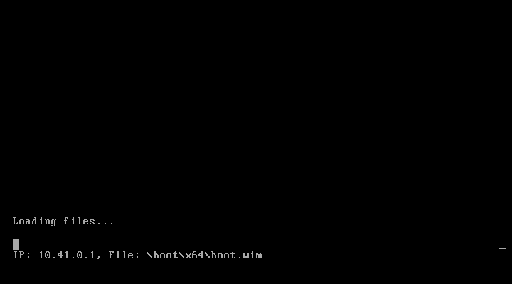
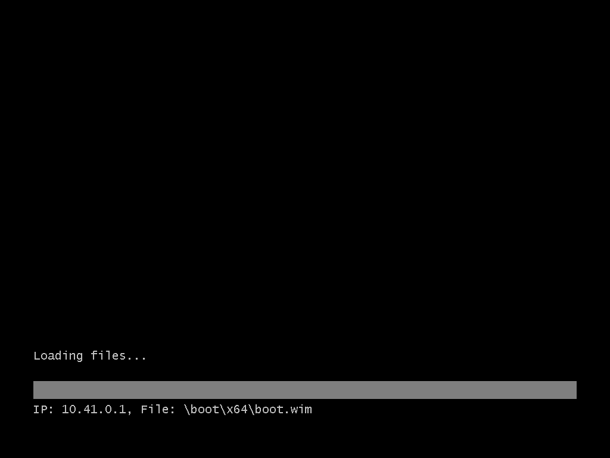
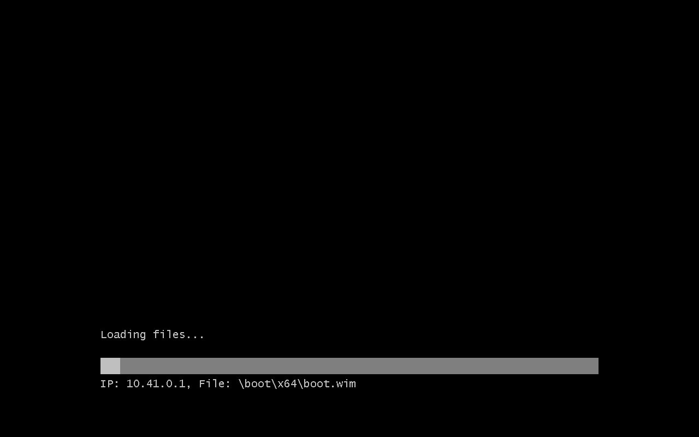

# An empty boot fonts folder in the PXE lab

This page records what each boot manager does when `\boot\fonts` is empty, for [#347](https://github.com/Tsukidy/deployarr/issues/347). The `bios` VM boots `pxeboot.n12` and then the 2011-signed `bootmgr.exe`. The `uefi2023` VM boots the 2023-signed `bootmgfw.efi`. Each run serves a TFTP root whose `boot/fonts` folder is empty, so the request for `\boot\fonts\wgl4_boot.ttf` gets File not found. The runs test the first bullet of [What is inferred](boot-fonts.md#what-is-inferred) on the boot fonts page of #222. Both runs drew text that differs from the #222 control, so each VM also got a fresh control from the #222 control's lab root. The runs are from 2026-11-20, on the lab host.

Paths in code font that start with `runs/`, `captures/`, `tftp/`, or `plans/` are relative to `~/deployarr-lab` on the lab host. They are outside the repository.

## Result

| Run | Boot manager | TFTP root | Font requests | `Loading files...` screen | Text against the #222 control | WinPE |
| --- | --- | --- | --- | --- | --- | --- |
| `bios` | `pxeboot.n12`, then the 2011-signed `bootmgr.exe` | `runs/347/roots/bios`, the `2011` root with an empty `boot/fonts` | `\boot\fonts\wgl4_boot.ttf` twice, File not found both times | 720x400, text-mode glyphs | Differs | Starts |
| `bios-control` | `pxeboot.n12`, then the 2011-signed `bootmgr.exe` | `tftp/2011`, unchanged, with `Fonts` | `\boot\fonts\wgl4_boot.ttf` twice, the second complete, 50096 bytes | 1024x768, as in #222 | Same text bands | Starts |
| `uefi2023` | The 2023-signed `bootmgfw.efi` | `runs/347/roots/uefi2023`, the `2023` root with an empty `boot/fonts` | `\boot\fonts\wgl4_boot.ttf` twice, File not found both times | 1280x800, smaller glyphs in another place | Differs | Starts |
| `uefi2023-control` | The 2023-signed `bootmgfw.efi` | `tftp/2023`, unchanged, with `Fonts_EX` | `\boot\fonts\wgl4_boot.ttf` twice, the second complete, 50120 bytes | 1280x800, as in #222 | Same file as #222's frame | Starts |

- Neither boot manager stopped at the missing font. Each asked for `\boot\fonts\wgl4_boot.ttf` twice, with `tsize=0` both times, and got File not found both times. Then each loaded `boot.sdi` and `boot.wim`, asked for `UnlockToken.pol`, and started WinPE.
- Neither asked for another font, or for the font at another path. Each run's `derived/requests.txt` reads `fonts_requested=wgl4_boot.ttf`, `other_fonts=none`, and `default_path_fonts=none`.
- Without the font, each boot manager drew the `Loading files...` screen in another way. On `bios`, the screen stayed 720x400, where #222's was 1024x768, and showed text-mode glyphs. On `uefi2023`, the screen was 1280x800 as in #222, but the glyphs were smaller, of another typeface, and higher and further right. For both runs, `textrows.py compare` against #222's control frame prints `text bands differ` (`runs/347/<run>/derived/compare-222.txt`).
- Each fresh control served the #222 control's lab root, unchanged. Each made #222's requests and drew #222's text bands, and each `derived/control.txt` reads `FRESH-CONTROL-SAME-AS-222`. The `uefi2023-control` frame is the same file as #222's control frame. So the lab still draws #222's pixels when it serves the font, and the empty folder made the difference.
- So the #222 inference holds. The boot managers drew #222's `Loading files...` pixels only when the font was served. [The inference under test](#the-inference-under-test) gives the reasoning.
- No run paused before `boot.wim`. In every run, `frames.py select` found no gap of 3 seconds or more between TFTP log lines after the store (`derived/selected.txt`, `NONE hold`). So the owner's rule for a pause with equal text bands ([Owner input on #347](https://github.com/Tsukidy/deployarr/issues/347#issuecomment-7052242379)) had no case to apply to.
- WinPE's own screen did not change. Each run's last screendump shows WinPE's `cmd.exe` window after `wpeinit`, with the same text bands as its control's last screendump (`derived/selected.txt`, `LAST`).

## The inference under test

[What is inferred](boot-fonts.md#what-is-inferred) on the boot fonts page says:

> The boot manager drew the text with the served font (inferred). Each run's text matches its control's pixel for pixel. The two `wgl4_boot.ttf` files hold the same glyph, bitmap, and metric tables byte for byte ([The two font sets](boot-fonts.md#the-two-font-sets)), so either file gives the same pixels. #27's frames give the same pixels too. A boot manager that drew with a fallback of its own could also give these pixels. No run served an empty `boot/fonts`, so these runs cannot tell the two cases apart.

The brief set the reading. Different or missing text supports the inference. The same pixels would mean a fallback that draws them.

- Both runs drew different text ([Screens](#screens)).
- Each run differs from its fresh control only in `boot/fonts`. Its root is the control's root less the 16 fonts, with every other file a hard link to the control's file ([The TFTP roots](#the-tftp-roots)). The request sequences differ only in the second font request, which carried `tsize=0` in the run and `tsize=0,blksize=1456` in the control (`derived/rrq-diff-222.txt`).
- The fresh controls, run a few minutes after each run on the same host, drew #222's pixels ([Controls](#controls)).
- So serving `wgl4_boot.ttf` is what gave #222's pixels. A fallback that drew the same pixels would have given #222's text bands in these runs. It did not.

Each boot manager did draw a screen without the font, so it has a fallback. The fallback draws other pixels. It looks like a text console of 80 columns and 25 rows (inferred, see [What is inferred](#what-is-inferred)).

## Setup

| Item | Value |
| --- | --- |
| Lab host | Ubuntu 26.04.1 LTS, kernel `7.0.0-43-generic`, AMD Ryzen 7 7700X, KVM, `nproc` 6. Before the runs, `free -m` gave 15428 MiB total, 11446 MiB free, and 14093 MiB available (`runs/347/host/env-before.txt`). |
| Lab scripts and PXE prototype | `tools/lab/` and `tools/pxe-prototype/` in the lab checkout `~/deployarr-lab/main` at `dbea61c`, with no local change. Each run's `env.txt` reads `lab_pin=dbea61c...` and `pin_diff=none`. [Lab changes since #222](#lab-changes-since-222) gives the difference from #222's `3fc0d3f`. |
| Network | As in [Setup](boot-fonts.md#setup) of the boot fonts page. `network.sh status` ended `The uplink is off. net.ipv4.ip_forward = 0.` before and after the runs (`host/network-status-before.txt`, `host/network-status-after.txt`). |
| Chain | `--chain single`, with the default stores `boot\bios.bcd` and `boot\uefi.bcd`, 12288 bytes each. Each run's `times.txt` reads `store_served=yes`. |
| TFTP roots | `runs/347/roots/bios` and `runs/347/roots/uefi2023` for the two runs ([The TFTP roots](#the-tftp-roots)). The controls served `tftp/2011` and `tftp/2023` themselves, as #222's controls did. |
| `uefi2023` VM | As in [Setup](boot-fonts.md#setup) of the boot fonts page. Its variable store was a fresh copy of `OVMF_VARS_4M.win23.fd`, checked with `cmp` (`runs/347/<run>/vmfolder.txt`, `vars.fd-is-template-copy`). After each run, `virt-fw-vars` read `SecureBootEnable    : bool: ON` from it (`derived/secure-boot.txt`). |
| `bios` VM | As in [Setup](boot-fonts.md#setup) of the boot fonts page |
| VM folders | `runs/347/<run>/<vm>/`, new for each run, through `LAB_DIR=runs/347/<run>`. The run script did not touch `~/deployarr-lab/bios` or `~/deployarr-lab/uefi2023` (`host/labvm-before.txt` and `host/labvm-after.txt` are the same). |
| Screendumps | One about every second, one more right after each log line for a font or `UnlockToken.pol`, and a last one before the stop (`runs/347/<run>/shots/shots.tsv`). #222 took one about every 2 seconds, so a `boot.wim` window here holds about twice as many frames. |

The prototype's `started` line names the run's root, `chain=single`, `dhcp_ports=67,4011`, and the default stores. On `bios`, the ACK named `boot\x64\pxeboot.n12` and option 252 = `boot\bios.bcd`. On `uefi2023`, the ACK named `boot\x64\bootmgfw.efi` and option 252 = `boot\uefi.bcd`.

| Run | VM start | Last screendump | Stop rule |
| --- | --- | --- | --- |
| `bios` | 22:33:44.813 | 22:35:55.554, 130.741 s after VM start | `loader+30` |
| `bios-control` | 22:37:03.658 | 22:39:14.158, 130.500 s | `loader+30` |
| `uefi2023` | 22:40:20.620 | 22:41:50.943, 90.323 s | `loader+30` |
| `uefi2023-control` | 22:43:01.289 | 22:44:30.587, 89.299 s | `loader+30` |

The VM start comes from each run's `times.txt`. The last screendump comes from the last row of `shots.tsv`, after the screendump returned (`runs/347/derived-page/stop-times.txt`). The runs ran in this order, one at a time. The run script wrote the wall clock and `/proc/uptime` at each step. Within each run, wall clock minus uptime stays within 0.010 seconds, and puts the host's start at 2026-11-18 20:40:58 UTC for all four runs (`derived-page/clock.txt`). So the host did not restart during the runs. It is the same boot as #222's run 2.

### Lab changes since #222

`host/lab-diff-before.txt` holds the full `git diff 3fc0d3f dbea61c -- tools/lab tools/pxe-prototype`. It changes three files.

- `tools/lab/lab.conf` adds `SUBNET=10.41.0.0/24` and the uplink's `UPLINK_TABLE` and `UPLINK_DNS`.
- `tools/lab/network.sh` adds the opt-in NAT uplink, with `UPLINK=${LAB_UPLINK:-0}`. It stays off unless `LAB_UPLINK=1`.
- `tools/pxe-prototype/README.md` changes text about option 97.

`tools/lab/vm.sh` and the prototype's `.py` files are not in the diff. `host/lab-diff-after.txt` is the same as the record before. The run script refused to start unless `git diff --stat dbea61c HEAD -- tools/lab tools/pxe-prototype` printed nothing. With the uplink off, the runs used the same lab code as #222, and the fresh controls gave #222's requests and pixels.

### The TFTP roots

Each root sits outside the repository, in `runs/347/roots/<vm>`. `build_root.sh` built both at 22:33:38 UTC, before the first run. It logged each command before it ran, in `runs/347/roots/bios-build.txt` and `runs/347/roots/uefi2023-build.txt`. These are the commands:

```bash
cp -al /home/user/deployarr-lab/tftp/2011 /home/user/deployarr-lab/runs/347/roots/bios
find /home/user/deployarr-lab/runs/347/roots/bios/boot/fonts -mindepth 1 -maxdepth 1 -type f -print -delete
cp -al /home/user/deployarr-lab/tftp/2023 /home/user/deployarr-lab/runs/347/roots/uefi2023
find /home/user/deployarr-lab/runs/347/roots/uefi2023/boot/fonts -mindepth 1 -maxdepth 1 -type f -print -delete
```

`cp -al` makes new directories and a hard link for each file. `find -print -delete` unlinks the 16 font names in the new `boot/fonts` and prints each one. No file was opened for writing, copied, or changed in mode. The new `boot/fonts` folder stays, with mode 775.

Each build file records this proof:

- `files=15 links=15 variants=0 not_a_link=0`. Each of the 15 files has the inode of the same path in its base root.
- `## find -type f -links 1: none`. No `SYMLINK` line appears, so the root holds no symbolic link (`build_root.sh` lines 97 and 98).
- `fonts_entries=0` and `EMPTY-FONTS`. `boot/fonts` is an empty directory.
- `base_fonts=16` and `tree-less-fonts`. The root's tree is the base's tree less exactly its 16 `boot/fonts/*` files, and nothing is in the root only.
- The store is the base's own file. `boot/bios.bcd` has inode 2760027 and `boot/uefi.bcd` has inode 2760058, with the SHA-256 that `tftp/manifest.txt` gives, `5682186b...7b0d` and `c0164082...0224`.
- `base-fonts-unchanged`. The base's 16 fonts kept their inode, link count, size, and SHA-256. `manifest_font_lines=16` and `base-fonts-match-manifest` show that their hashes match `tftp/manifest.txt`.
- `## device ids: tftp 64512 roots 64512`.
- The last line is `ROOT-OK`.

Each run's `env.txt` printed `ABSENT boot/fonts/wgl4_boot.ttf` and `fonts_entries=0`. After each run, `times.txt` recorded `fonts_entries_after=0` and the store's inode unchanged.

Building the roots raised 31 link counts in `tftp/` by one and changed no inode (`host/links-after-build.txt`, `derived-page/host-checks.txt`). After the runs, `remove_roots.sh` checked each root again, 15 files linked to the base and no symbolic link or single-link file, and then removed both (`host/roots-removed-20261120T224556Z.txt`, `REMOVED`). Every link count came back. `host/links-after.txt` is the same as `host/links-before.txt`.

## Versions

`host/versions-before.txt` and `host/versions-after.txt` are the same. They list QEMU 10.2.1, SeaBIOS 1.17.0, OVMF 2025.11, ipxe-qemu 1.21.1+git-20250829.969ce2c55, swtpm 0.10.1, dnsmasq 2.92, tshark 4.6.4, Python 3.14.4, and OpenSSL 3.5.5, the versions of [Versions](boot-fonts.md#versions) on the boot fonts page. `host/firmware-before.txt` and `host/firmware-after.txt` are the same too. The `uefi2023` template `OVMF_VARS_4M.win23.fd` has the SHA-256 `16b2478518659d692b85cd6e400b23a28f924ec95a63da86e904d8e4792462d3`.

The runs served these files. Each size and SHA-256 comes from the `served` lines of `derived/requests.txt`, which hash the path the prototype logged for a complete transfer.

| File | Served in | Bytes | SHA-256 |
| --- | --- | --- | --- |
| `boot/x64/pxeboot.n12` | Both `bios` runs | 25238 | `9e34cbc08fc26902f351889b8c29c80b5f6ec99f1bb44dcf083ba2b988e37267` |
| `boot/x64/bootmgr.exe` | Both `bios` runs | 814544 | `364c896a4fd4690949d1f7c386332f4f32541b01a05adfc13b7178258571a7ad` |
| `boot/x64/bootmgfw.efi`, 2023-signed | Both `uefi2023` runs | 3087200 | `25d8869e3c79083ae62c698a9db9030748e3267bd53593357447f3f72761d1f2` |
| `boot/fonts/wgl4_boot.ttf`, `Fonts` | `bios-control` | 50096 | `23872d2eba60bbb3bd2585e925c4b48769fb6bb0cfa7f4a6ba4e8f03bcaf2c35` |
| `boot/fonts/wgl4_boot.ttf`, `Fonts_EX` | `uefi2023-control` | 50120 | `74e2d0cead72021c944bc4a2941406ffa6def152818c5faec88472452ae42d00` |
| `boot/bios.bcd` | Both `bios` runs | 12288 | `5682186b6906955f5f5e610aee7dc9eb66e3d5314d31141c5ff9b1a0750e7b0d` |
| `boot/uefi.bcd` | Both `uefi2023` runs | 12288 | `c0164082153aa4eeb826b68d9e3acb4ad815fbf64b8dc1b8a51ef0f02d010224` |
| `boot/boot.sdi` | All four | 3170304 | `cd2c00ce027687ce4a8bdc967f26a8ab82f651c9becd703658ba282ec49702bd` |

`boot/x64/boot.wim` is 572691590 bytes in every run. It is one inode, 2759775, linked into both lab roots and both run roots (`roots/<vm>-build.txt`). It is the image in [Versions](boot-fonts.md#versions) of the boot fonts page. Each file above is the one the boot fonts page gives for the same path.

## The `bios` VM

| Event | Run, empty `boot/fonts` | Fresh control, `Fonts` |
| --- | --- | --- |
| First RRQ, `boot\x64\pxeboot.n12` | 22:33:52.195, 7.382 s after VM start | 22:37:11.036, 7.378 s |
| Font RRQs | 22:33:52.553, 7.740 s, both File not found | 22:37:11.392, 7.734 s, the second complete at 7.743 s |
| `boot.wim` RRQ with `blksize` | 22:33:53.590, 8.777 s | 22:37:11.921, 8.263 s |
| `boot.wim` complete | 22:35:24.583, 99.770 s | 22:38:44.506, 100.848 s |
| `boot.wim` transfer | 90.993 s | 92.585 s |
| `UnlockToken.pol` RRQ | 22:35:24.877, 100.064 s | 22:38:44.737, 101.079 s |
| WinPE's DISCOVER | 22:35:37.762, 112.949 s | 22:38:57.621, 113.963 s |

The times come from the prototype's log, and the VM start from the run script (`derived-page/timings.txt`). Each `boot.wim` transfer sent 393333 blocks with no retransmit.

### Run with an empty `boot/fonts`

The run made 13 TFTP requests (`runs/347/bios/derived/requests.txt`).

| RRQ | File | Options | Outcome |
| --- | --- | --- | --- |
| 1 | `boot\x64\pxeboot.n12` | `blksize=1432,tsize=0` | Complete, 25238 bytes |
| 2 | `boot\x64\bootmgr.exe` | `blksize=512,tsize=0` | Complete, 814544 bytes |
| 3 | `\boot\bios.bcd` | `tsize=0` | OACK, then `0 TFTP Aborted` from the client |
| 4 | `\boot\bios.bcd` | `tsize=0,blksize=1456` | Complete, 12288 bytes |
| 5 | `\EFI\Microsoft\Boot\SecureBootPolicy.p7b` | `tsize=0` | File not found |
| 6 | `\hiberfil.sys` | `tsize=0` | File not found |
| 7 | `\boot\x64\boot.wim` | `tsize=0` | OACK, then `0 TFTP Aborted` |
| 8 | `\boot\boot.sdi` | `tsize=0` | OACK, then `0 TFTP Aborted` |
| 9 | `\boot\fonts\wgl4_boot.ttf` | `tsize=0` | File not found |
| 10 | `\boot\fonts\wgl4_boot.ttf` | `tsize=0` | File not found |
| 11 | `\boot\boot.sdi` | `tsize=0,blksize=1456` | Complete, 3170304 bytes |
| 12 | `\boot\x64\boot.wim` | `tsize=0,blksize=1456` | Complete, 572691590 bytes |
| 13 | `\EFI\Microsoft\Boot\Policies\UnlockToken.pol` | `tsize=0` | File not found |

- The requests are those of #222's `bios` control, file for file, except RRQ 10. In #222's control and in the fresh control, RRQ 10 carried `tsize=0,blksize=1456` and completed. Here it carried `tsize=0` (`derived/rrq-diff-222.txt`).
- Lines 33 to 36 of `prototype.log` hold the font requests. RRQ 9 came from `10.41.0.192:6702`, and the prototype sent `kind=ERROR code=1 message="File not found"` to the same client. RRQ 10 came from port 6703 and got the same reply. Both came at 22:33:52.553, and the second reply at 22:33:52.554. No `transfer-finished` line names either client (`font_late_finish=no`).
- RRQ 11, for `boot.sdi`, came 61 ms after the second reply.
- Frame `0010.png`, taken at 22:33:53.347 right after the font requests, shows `Loading files...`, a bar, and `IP: 10.41.0.1, File: \boot\boot.sdi` on a 720x400 screen. Every frame from `0001.png` to `0098.png` is 720x400. The screen turned 1024x768 only at `0099.png`, 22:35:25.264, after `boot.wim` completed (`derived-page/frame-sizes.txt`). In the fresh control, it turned 1024x768 at `0009.png`, 22:37:12.163, right after the font loaded.
- From `0012.png` to `0098.png`, the screen shows `Loading files...`, the bar, and `IP: 10.41.0.1, File: \boot\x64\boot.wim`.
- WinPE's DISCOVER and REQUEST carry option 60 `MSFT 5.0`. They are frames 37 and 39 of the committed capture, and dnsmasq answers each from `10.41.0.2`, in frames 38 and 40 (`derived/winpe-dhcp.txt`, `derived-page/dhcp-fields.txt`). The prototype logs both as `dhcp-ignored` with `reason=no-option-93`.
- The last screendump, `0130.png` at 22:35:55.548, shows the window `Administrator: X:\windows\system32\cmd.exe` at a prompt after `wpeinit` (`derived-page/winpe-read.txt`). So WinPE started.

### Fresh control with `Fonts`

- The 13 requests are #222's, file for file and option for option (`runs/347/bios-control/derived/rrq-diff-222.txt`, `SAME-AS-222`).
- RRQ 9 asked for `\boot\fonts\wgl4_boot.ttf` with `tsize=0`. The prototype sent an OACK with `tsize=50096`, and the client ended the transfer with `0 TFTP Aborted`. RRQ 10 asked again with `tsize=0,blksize=1456` and completed, 35 blocks in 0.009 seconds with no retransmit. The prototype logged the path `tftp/2011/boot/fonts/wgl4_boot.ttf`, the `Fonts` file.
- From `0011.png` to `0098.png`, the screen shows #222's `Loading files...` screen at 1024x768.
- WinPE's DISCOVER and REQUEST, with option 60 `MSFT 5.0`, are frames 38 and 40 of the committed capture.
- The last screendump, `0129.png` at 22:39:14.152, shows the same `cmd.exe` window after `wpeinit`.

## The `uefi2023` VM

| Event | Run, empty `boot/fonts` | Fresh control, `Fonts_EX` |
| --- | --- | --- |
| First RRQ, `boot\x64\bootmgfw.efi` | 22:40:27.462, 6.842 s after VM start | 22:43:08.080, 6.791 s |
| Font RRQs | 22:40:28.088, 7.468 s, both File not found | 22:43:08.706, 7.417 s, the second complete at 7.423 s |
| `boot.wim` RRQ with `blksize` | 22:40:28.679, 8.059 s | 22:43:09.065, 7.776 s |
| `boot.wim` complete | 22:41:19.690, 59.070 s | 22:43:59.517, 58.228 s |
| `boot.wim` transfer | 51.011 s | 50.452 s |
| `UnlockToken.pol` RRQ | 22:41:19.832, 59.212 s | 22:43:59.666, 58.377 s |

The times come from the prototype's log, and the VM start from the run script (`derived-page/timings.txt`). Each `boot.wim` transfer sent 393333 blocks with no retransmit. In both runs, the committed capture holds 7 DHCP packets, all from the firmware's PXE exchange, and none from WinPE (`derived-page/dhcp-fields.txt`). WinPE on this VM has no driver for its virtio-net card (inferred, see [What is inferred](#what-is-inferred)).

### Run with an empty `boot/fonts`

The run made 32 TFTP requests (`runs/347/uefi2023/derived/requests.txt`).

| RRQ | File | Outcome |
| --- | --- | --- |
| 1 | `boot\x64\bootmgfw.efi`, `tsize=0,blksize=1468,windowsize=4` | OACK, then `8 User aborted the transfer` from the client |
| 2 | `boot\x64\bootmgfw.efi`, `blksize=1468,windowsize=4` | Complete, 3087200 bytes |
| 3 | `\boot\x64\BCD` | File not found |
| 4 | `\boot\uefi.bcd`, `tsize=0` | OACK, then `0 TFTP Aborted` |
| 5 | `\boot\uefi.bcd`, `tsize=0,blksize=1456` | Complete, 12288 bytes |
| 6 to 21 | 16 policy files under `\EFI\Microsoft\Boot\`, as in #222 | File not found, each |
| 22 | `\boot\x64\bootmgfw.efi`, `tsize=0` | OACK, then `0 TFTP Aborted` |
| 23 | `\boot\x64\bootmgfw.efi`, `tsize=0,blksize=1456` | Complete, 3087200 bytes |
| 24, 25 | `\EFI\Microsoft\Boot\boot.stl`, `\boot\x64\boot.stl` | File not found, each |
| 26, 27 | `\boot\x64\boot.wim`, `\boot\boot.sdi`, `tsize=0` | OACK, then `0 TFTP Aborted`, each |
| 28 | `\boot\fonts\wgl4_boot.ttf`, `tsize=0` | File not found |
| 29 | `\boot\fonts\wgl4_boot.ttf`, `tsize=0` | File not found |
| 30 | `\boot\boot.sdi`, `tsize=0,blksize=1456` | Complete, 3170304 bytes |
| 31 | `\boot\x64\boot.wim`, `tsize=0,blksize=1456` | Complete, 572691590 bytes |
| 32 | `\EFI\Microsoft\Boot\Policies\UnlockToken.pol`, `tsize=0` | File not found |

RRQs 3 to 32 carried `tsize=0` unless the table names other options.

- The requests are those of #222's `uefi2023` control, file for file, except RRQ 29. In #222's control and in the fresh control, RRQ 29 carried `tsize=0,blksize=1456` and completed. Here it carried `tsize=0` (`derived/rrq-diff-222.txt`).
- RRQ 28 came from `10.41.0.177:10149` and RRQ 29 from port 10150, both at 22:40:28.088. The prototype sent `kind=ERROR code=1 message="File not found"` to each client. No `transfer-finished` line names either client (`font_late_finish=no`). RRQ 30, for `boot.sdi`, came 23 ms later.
- The serial log is 24735 bytes. Its first 668 bytes are the control's whole serial log, which ends with OVMF's `BdsDxe: starting Boot0003`. After them, the run's log holds the boot manager's screen as text. It holds `Loading files...` twice, `IP: 10.41.0.1, File: \boot\boot.sdi` once, and `IP: 10.41.0.1, File: \boot\x64\boot.wim` once, each after a cursor escape to row 20 or row 23 and column 3. It also holds 196 updates of a bar on row 22, from column 3 (`derived-page/serial-logs.txt`).
- Frame `0009.png`, taken at 22:40:28.236 right after the font requests, shows `Loading files...`, a short bar, and `IP: 10.41.0.1, File: \boot\boot.sdi` in small glyphs. From `0011.png` to `0058.png`, the screen shows `Loading files...`, the bar, and `IP: 10.41.0.1, File: \boot\x64\boot.wim` in the same glyphs.
- The last screendump, `0090.png` at 22:41:50.935, shows the window `Administrator: X:\windows\system32\cmd.exe` at a prompt after `wpeinit` (`derived-page/winpe-read.txt`). So WinPE started.

### Fresh control with `Fonts_EX`

- The 32 requests are #222's, file for file and option for option (`runs/347/uefi2023-control/derived/rrq-diff-222.txt`, `SAME-AS-222`).
- RRQ 28 got an OACK with `tsize=50120`, and the client ended it with `0 TFTP Aborted`. RRQ 29 asked again with `tsize=0,blksize=1456` and completed, 35 blocks in 0.005 seconds with no retransmit. The prototype logged the path `tftp/2023/boot/fonts/wgl4_boot.ttf`, the `Fonts_EX` file.
- The serial log is 668 bytes, with no `Loading files...`. It is the same file as #222's `uefi2023` control serial log (`derived-page/serial-logs.txt`, `SAME-AS-222-CONTROL-SERIAL`).
- From `0011.png` to `0057.png`, the screen shows #222's `Loading files...` screen.
- The last screendump, `0089.png` at 22:44:30.581, shows the same `cmd.exe` window after `wpeinit`.

## Screens

A run's `boot.wim` window starts 1 second after the `boot.wim` RRQ with `blksize` and ends at that transfer's `transfer-finished` line, as [Screens](boot-fonts.md#screens) of the boot fonts page defines it. The committed frame of each run is the first lit frame in its window (`derived/selected.txt`, `SELECT loading-files`). `runs/347/derived-page/screens-read.txt` records what each selected frame shows.

| Run | `Loading files...` screen |
| --- | --- |
| `bios`, empty `boot/fonts`, `0012.png`, 22:33:55.423 |  |
| `bios-control` with `Fonts`, `0011.png`, 22:37:13.250 |  |
| `uefi2023`, empty `boot/fonts`, `0011.png`, 22:40:30.338 |  |
| `uefi2023-control` with `Fonts_EX`, `0011.png`, 22:43:11.030 |  |

`textrows.py` split each frame into bands, as [Screens](boot-fonts.md#screens) of the boot fonts page describes. These are the bands of the two runs' committed frames (`derived/compare-222.txt`). #222's control bands are in the boot fonts page's table.

| Run | Frame size | Band | Rows | Columns | SHA-256 |
| --- | --- | --- | --- | --- | --- |
| `bios` | 720x400 | `Loading files...` | 306 to 318 | 18 to 157 | `6e7c79735910f7b9bc13250fc25b981ce35c775d677332a2f0eb09854a963f69` |
| `bios` | 720x400 | Bar row | 336 to 351 | 18 to 710 | `4cc5cf596b855278613fe87c2042e025c06d524706832687ef924d21363757c2` |
| `bios` | 720x400 | `IP: 10.41.0.1, File: \boot\x64\boot.wim` | 354 to 364 | 20 to 367 | `2ab750396229e5b7286e87f23ec67f4ddef5c3f5c9a388f539011cc50cec9954` |
| `uefi2023` | 1280x800 | `Loading files...` | 526 to 540 | 336 to 460 | `071aff4053f9658c823a292d2de3dc1c7b4fb712e88e6b58ce3bedd01fea1cdd` |
| `uefi2023` | 1280x800 | Bar row | 561 to 579 | 336 to 351 | `5cd3f1d273f926c0e66f5b698b614447681cb036e8ec6df2d4af8d43bd89294b` |
| `uefi2023` | 1280x800 | `IP: 10.41.0.1, File: \boot\x64\boot.wim` | 583 to 594 | 336 to 646 | `3959ce3ed786587336fec37f8a97e849d0a56747425977741962156a62343ca6` |

- The `bios` frame has another size than #222's 1024x768 control frame, so `compare` gives no per-band pixel count. It prints `text bands differ` and exits 1.
- The `uefi2023` frame has #222's size. Each of #222's text bands differs from the run's frame at the same rows, in 639 pixels for `Loading files...` and in 1582 pixels for the `IP` line. The run's own bands sit at other rows.
- Both fresh controls print `text bands equal` against #222's control frame (`compare_exit=0`). The `uefi2023-control` frame is the same file as #222's `boot-fonts-uefi2023-control-loading-files.png`. The `bios-control` frame differs from #222's only in the bar band, which shows another point of progress (`derived-page/repo-checks.txt`, `derived/compare-222.txt`).

| Run | `boot.wim` RRQ to `transfer-finished` | Frames in the window | Sets of text bands | `window_exit` |
| --- | --- | --- | --- | --- |
| `bios` | 22:33:53.590 to 22:35:24.583 | 87, `0012.png` to `0098.png` | 78 | 1 |
| `bios-control` | 22:37:11.921 to 22:38:44.506 | 88, `0011.png` to `0098.png` | 1 | 0 |
| `uefi2023` | 22:40:28.679 to 22:41:19.690 | 48, `0011.png` to `0058.png` | 48 | 1 |
| `uefi2023-control` | 22:43:09.065 to 22:43:59.517 | 47, `0011.png` to `0057.png` | 1 | 0 |

The text itself did not change within either run's window. `window_exit=1` comes from the bar row. `textrows.py` takes a band as the bar only when its first row has 600 or more lit pixels. In the run frames, the bar is a row of text cells, and its first row holds fewer lit pixels until the bar fills, so `textrows.py` counts it as a text band that changes with progress. `derived-page/band-presence.txt` shows this per band.

- On `bios`, rows 306 to 318 and rows 354 to 364 have one SHA-256 in all 87 frames. Rows 336 to 351 have 87 values. `textrows.py` called that band text in 77 frames and the bar in 10.
- On `uefi2023`, rows 526 to 540 and rows 583 to 594 have one SHA-256 in all 48 frames. Rows 561 to 579 have 48 values.

In both runs, every band sits in one row of cells of an 80-column, 25-row text grid (`derived-page/geometry.txt`). On `bios`, the grid has 9x16 cells and fills the 720x400 frame. On `uefi2023`, it has 8x19 cells and sits in the middle of the 1280x800 frame, from x=320 and y=162. In both, `Loading files...` is on text row 20, the bar on row 22, and the `IP` line on row 23, each from column 3. These are the rows and the column of the cursor escapes in the `uefi2023` run's serial log. So each boot manager wrote the screen as text on a text console when it had no font (inferred, see [What is inferred](#what-is-inferred)).

The selection found no `hold` frame in any run, so `derived/match-222.txt` compares only the `boot.wim` window and the committed frames. For both runs, every band at the run's rows is `ONLY-IN-B` and every band at #222's rows is `ONLY-IN-A`, and the file reads `SCREENS-DIFFER`. For both controls it reads `SCREENS-MATCH`.

## Controls

Each run's `derived/control.txt` reads `same_text_as_222=no` and `CONTROL=needed`, with three reasons.

- `compare-222.txt` does not end `text bands equal` with `compare_exit=0`.
- `window_exit=1`.
- `match-222.txt` does not read `SCREENS-MATCH`.

The first reason alone makes the text differ. The other two follow from it and from the bar row ([Screens](#screens)). As the owner chose ([Owner input on #347](https://github.com/Tsukidy/deployarr/issues/347#issuecomment-7050660624)), each VM then got a fresh control from #222's lab root, unchanged. Before it started each control, the run script checked the store, the boot manager, and `wgl4_boot.ttf` against `tftp/manifest.txt` (`run.sh` lines 129 to 154). Each control's `env.txt` lists their hashes. Each control's `control.txt` reads `same_text_as_222=yes` and `FRESH-CONTROL-SAME-AS-222`. Its requests are `SAME-AS-222`, its text bands equal #222's (`compare_exit=0`), its window holds one set of text bands (`window_exit=0`), and `match-222.txt` reads `SCREENS-MATCH`.

Each control's full capture also has the packet and byte count of #222's control on the same VM, as [Captures](boot-fonts.md#captures) of the boot fonts page gives them.

## Captures

| File | What it holds |
| --- | --- |
| [`no-boot-fonts-bios.pcapng`](captures/no-boot-fonts-bios.pcapng) | `bios` with an empty `boot/fonts`, reduced |
| [`no-boot-fonts-bios-control.pcapng`](captures/no-boot-fonts-bios-control.pcapng) | `bios` fresh control with `Fonts`, reduced |
| [`no-boot-fonts-uefi2023.pcapng`](captures/no-boot-fonts-uefi2023.pcapng) | `uefi2023` with an empty `boot/fonts`, reduced |
| [`no-boot-fonts-uefi2023-control.pcapng`](captures/no-boot-fonts-uefi2023-control.pcapng) | `uefi2023` fresh control with `Fonts_EX`, reduced |

Each capture has a `tshark -V` decode of its DHCP packets next to it, with `-dhcp.txt` in place of `.pcapng`. `dumpcap` captured with the filter `udp and udp[8:2] != 3`, which drops TFTP DATA packets and IP fragments. The committed files went through `tshark -r - -Y 'not tftp.opcode == 4' -w -`, which drops the TFTP ACKs. The full captures stay on the lab host in `captures/`.

| Run | Full capture | Dropped TFTP ACKs | Committed copy |
| --- | --- | --- | --- |
| `bios` | 397,186 packets, 31,780,260 bytes, SHA-256 `c0f5b8a3ab2c8a9c2096d84d6e670535a4668e32f39ee60324599025b0c6135a` | 397,134 | 52 packets, 9,432 bytes, SHA-256 `96c045622193fcc26167dfa32c145b10ca16a08fa66ceb50c1b949a837a2e862` |
| `bios-control` | 397,223 packets, 31,783,248 bytes, SHA-256 `312d6a9805d0583268e6d4bf6940e2419be78ea98ee5d1ee1fa8b240b087d5d3` | 397,170 | 53 packets, 9,540 bytes, SHA-256 `cb4ff55b04232b6c092fa32fe35ee28fa02e3ceb99751f934057d5f805385f87` |
| `uefi2023` | 398,248 packets, 31,864,452 bytes, SHA-256 `2eed538f339311142a3e5949a9c6fe57335a9cf5949b4c6c07d36423fe52bd2e` | 398,172 | 76 packets, 10,584 bytes, SHA-256 `a07340dc6a3f01a2a2dbb0bf12a60d338d4713d0b9605c34ec5c8ec2b86fc574` |
| `uefi2023-control` | 398,285 packets, 31,867,440 bytes, SHA-256 `f8070d684d7d72e6d52845a8609213bb2f7ed78e19b183b584cd29d7a5b222dc` | 398,208 | 77 packets, 10,692 bytes, SHA-256 `d360e67d1f844c7f7ac384f620278256974bf12aa29fa0c14aeafdda94eb4eba` |

- The counts come from each run's `derived/capture-checks.txt`. The `dumpcap` logs, next to the full captures, report no dropped packets.
- Each run's full capture has 37 packets fewer than its control's. It has 36 fewer TFTP ACKs, 2 fewer OACKs, and 1 more ERROR packet (`tftp_acks`, `tftp_oacks`, and `tftp_errors` in `capture-checks.txt`). That fits the font transfer of 35 blocks and the two OACKs that the run did not get (inferred).
- The TFTP data and fragment check from the lab guide prints nothing for the full and the committed captures. So do the filters `udp.payload[0:2] == 00:03` and `ipv6.fragment or ipv6.fraghdr` (`derived/capture-checks.txt`, `data_or_fragments=0 raw_data=0 ipv6_fragments=0`). The same three filters print nothing for the copies in the repository either (`derived-page/repo-checks.txt`).
- The committed copies come out byte for byte the same when made again from the full captures (`copy-reproducible`). The decodes made again from the copies in the repository are the same files too (`decode-remade-same`).

The raw evidence stays on the lab host in `runs/347/`: the prototype logs, the serial logs, every screendump, the clock stamps, the build and removal records, and the scripts.

## Commands

The plan the runs followed is `plans/347/plan.md`. The scripts live in `runs/347/tools/`, and `runs/347/tools/tools.sha256` holds their hashes. Each run's `env.txt` shows the check under `## tools`, with `OK` for each script. `run.sh` starts from #346's run script, kept beside it as `run.sh.from-346`, and `run.sh.diff` holds the diff.

```bash
bash ~/deployarr-lab/runs/347/tools/build_root.sh bios
bash ~/deployarr-lab/runs/347/tools/build_root.sh uefi2023
bash ~/deployarr-lab/runs/347/tools/run.sh bios
bash ~/deployarr-lab/runs/347/tools/derive.sh bios
bash ~/deployarr-lab/runs/347/tools/run.sh bios-control
bash ~/deployarr-lab/runs/347/tools/derive.sh bios-control
bash ~/deployarr-lab/runs/347/tools/run.sh uefi2023
bash ~/deployarr-lab/runs/347/tools/derive.sh uefi2023
bash ~/deployarr-lab/runs/347/tools/run.sh uefi2023-control
bash ~/deployarr-lab/runs/347/tools/derive.sh uefi2023-control
bash ~/deployarr-lab/runs/347/tools/copy.sh <run>
bash ~/deployarr-lab/runs/347/tools/remove_roots.sh
bash ~/deployarr-lab/runs/347/derived-page/make.sh
```

`run.sh` started the prototype, then the capture, then the VM, as [Run an experiment](../../lab-setup.md#run-an-experiment) says (`run.sh` lines 439 to 476). `$LAB` is `~/deployarr-lab/main`, `<root>` is the run's root, and `<vm>` is `bios` or `uefi2023`. Each run's `prototype-proc.txt` and `dumpcap-proc.txt` record the command lines of the real processes.

```bash
sudo -n timeout -s INT -k 10 660 python3 -B $LAB/tools/pxe-prototype/pxe_prototype.py --server-ip 10.41.0.1 --interface br-lab --root <root> --chain single --no-block-log --log-file ~/deployarr-lab/runs/347/<run>/prototype.log
sudo -n dumpcap -i br-lab -f 'udp and udp[8:2] != 3' -a duration:600 -w - > ~/deployarr-lab/captures/no-boot-fonts-<run>.pcapng
LAB_DIR=~/deployarr-lab/runs/347/<run> timeout -k 15 420 $LAB/tools/lab/vm.sh <vm> -display none -monitor unix:~/deployarr-lab/runs/347/<run>/mon.sock,server,nowait
```

After each pass, the script sent the HMP command `screendump <file> -f png` through the monitor socket. It stopped 30 seconds after the first `UnlockToken` line in the prototype's log (`run.sh` lines 111, 534 to 552). It counts with Bash's whole-second `SECONDS`, so the stops came 29.4 to 31.1 seconds after the request (`derived-page/stop-times.txt`). The other stop rules, `font-quiet+60`, `cap+240`, and `hard-cap+300`, did not fire. Then the HMP command `quit` stopped the VM, and `SIGINT` stopped the prototype and then `dumpcap`.

`derive.sh` made the committed files in `runs/347/commit/`, and `copy.sh` copied them to `docs/research/pxe-lab/captures/`. These are its capture and screen commands:

```bash
tshark -r - -Y 'not tftp.opcode == 4' -w - < ~/deployarr-lab/captures/no-boot-fonts-<run>.pcapng > ~/deployarr-lab/runs/347/commit/no-boot-fonts-<run>.pcapng
tshark -r - -Y 'tftp.opcode == 3 or ip.flags.mf == 1 or ip.frag_offset > 0' < ~/deployarr-lab/runs/347/commit/no-boot-fonts-<run>.pcapng
tshark -r - -Y 'udp.payload[0:2] == 00:03' < ~/deployarr-lab/runs/347/commit/no-boot-fonts-<run>.pcapng
tshark -r - -Y 'ipv6.fragment or ipv6.fraghdr' < ~/deployarr-lab/runs/347/commit/no-boot-fonts-<run>.pcapng
tshark -r - -Y dhcp -V < ~/deployarr-lab/runs/347/commit/no-boot-fonts-<run>.pcapng > ~/deployarr-lab/runs/347/commit/no-boot-fonts-<run>-dhcp.txt
python3 -I ~/deployarr-lab/runs/347/tools/textrows.py window ~/deployarr-lab/runs/347/<run>/prototype.log ~/deployarr-lab/runs/347/<run>/shots/*.png
python3 -I ~/deployarr-lab/runs/347/tools/textrows.py compare ~/deployarr-lab/runs/222/commit/boot-fonts-<vm>-control-loading-files.png ~/deployarr-lab/runs/347/commit/no-boot-fonts-<run>-loading-files.png
```

The three filters ran on the full captures as well. `derive.sh` also ran `rrq.py` for the request tables and `frames.py` for the selection and the window-wide match.

`derived-page/make.sh` makes every `derived-page` file this page cites, except `screens-read.txt` and `winpe-read.txt`, which record what the frames show. It reads the run evidence and the committed copies, writes only into `runs/347/derived-page/`, and starts no lab process.

| Script | SHA-256 |
| --- | --- |
| `run.sh` | `2b38ad21381b0b7deeb3f4102ff533b3a83d2be46df1433de0aa277ea91d4580` |
| `build_root.sh` | `57ba57a433d38180d0d38d8d6b493b06d59767797816823c7d7de60e44d5988c` |
| `derive.sh` | `43a788d866908b28af15be978c9f5072b6ddb4eb0922014e36d344ed91c3536b` |
| `copy.sh` | `36af4a606b478d88b06b82bb7e38c465c1f2621607fa83935b1aa9046f2ad289` |
| `remove_roots.sh` | `e5d30e7954ffa68240344ebf7a0f7dc6d99cf915bd251c20c6213c6f9ac63859` |
| `frames.py` | `8e54ba16ffbcb8c26b92c2e9c00b57d236291bf6735698692838daf0fa91d14b` |
| `rrq.py` | `3e963061a982f9cbfbbf3e7de0e35d2f0691f1555849685b3f713d35852a282b` |
| `mon.py` | `08ab1ac9343e872cfc954601a0ecce02d934379f28b5ecb7946ed91587f81bbe` |
| `textrows.py` | `89e24a012b23d6c6841a1f0173dbd918cda6aad36063705b809580f64fd21e83`, #222's script unchanged |
| `derived-page/make.sh` | `2dfe36236bbc814b59d89d752c329da0aa132816ec4e4b3b0e001f2824bf6621` |

## What is inferred

- Each boot manager fell back to a text console of 80 columns and 25 rows when it had no font (inferred). Every band of the run frames sits in one cell row of such a grid, at rows 20, 22, and 23 and column 3 ([Screens](#screens)). On `uefi2023`, the serial log carries the same text with cursor escapes to those rows and that column, and the control's serial log carries none. The same log carries OVMF's own console messages, such as `>>Start PXE over IPv4.`, so the run's text went to the firmware's text console (inferred). On `bios`, the 720x400 frame is the size of a VGA text mode of 80 by 25 cells of 9x16 pixels (inferred from the size). Which code drew the glyphs, the boot manager or the firmware, these runs do not show.
- The runs show that serving `wgl4_boot.ttf` decides which pixels the boot manager draws. They do not show which code in the boot manager reads the font.
- Each boot manager asks for the font twice whatever the reply (inferred from two runs). In #222 and the controls, the first request got an OACK with the size, the client ended it, and the second request added `blksize=1456`. Here both requests got File not found, and the second kept `tsize=0` only.
- A missing `boot/fonts` folder would act as an empty one did here (inferred, not run). The prototype's `resolve` answers File not found when any part of the path is missing (`tools/pxe-prototype/tftp.py` lines 133 to 154). So a missing folder gives the client the same reply as an empty one.
- On the `uefi2023` VM, the `UnlockToken.pol` request comes from the OS loader that the boot manager starts, as [What is inferred](single-stage-chain.md#what-is-inferred) of the single-stage page records. So it shows that the loader ran. Only the last screendump shows that WinPE started.
- WinPE on the `uefi2023` VM sends no DHCP because it has no driver for the virtio-net card, as [What is inferred](single-stage-chain.md#what-is-inferred) of the single-stage page records for the `uefi` VM.

## Not covered

- A store with no `fontpath`, and a root with no `boot/fonts` folder at all. Both runs served the default store and an empty folder.
- Fonts other than `wgl4_boot.ttf`, which [Boot fonts for a boot locale, the boot menu, and an error screen](other-boot-fonts.md) covers for #346. The runs asked for no other font.
- Other boot locales, the boot menu, and error screens without the font. No such screen ran here.
- The 2011-signed `bootmgfw.efi` on the `uefi` VM.
- The two-stage chain and `wdsmgfw.efi`.
- Other firmware, other builds of WinPE, and physical PCs. A text console fallback may look different on other firmware (inferred).

## What changes in deployarr

- The design needs no change. The one font folder of [What changes in deployarr](boot-fonts.md#what-changes-in-deployarr) on the boot fonts page stands. With the font at `\boot\fonts`, both boot managers draw their usual screen, as the fresh controls show.
- An empty `boot/fonts` does not stop either boot manager. Both loaded `boot.sdi` and `boot.wim`, and WinPE started. The boot manager's screen changed, to text in another typeface and place. The requests changed only in the second font request.
- So a font that the server fails to serve is a fault in the screen, not in the boot. [Boot chain](../../architecture.md#boot-chain) does not say what happens without the font. A separate pull request can add this result there.
