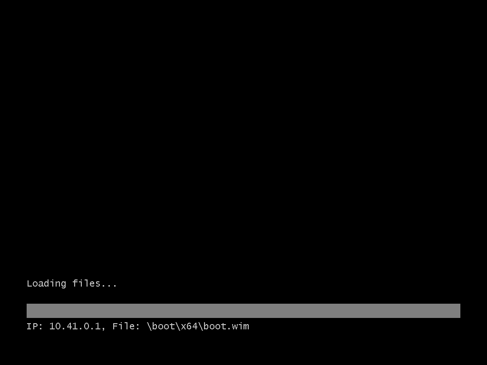
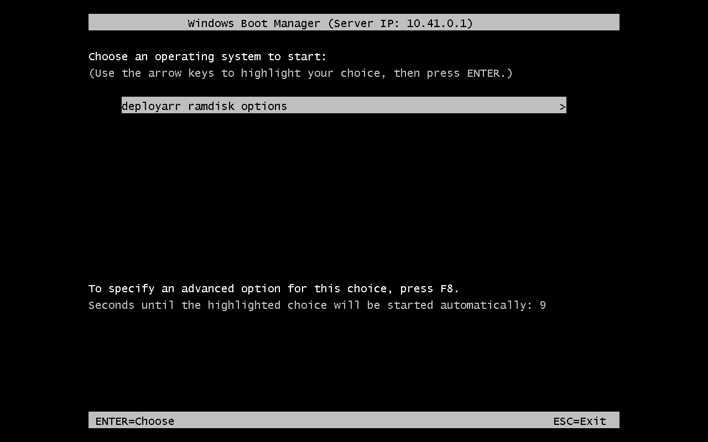
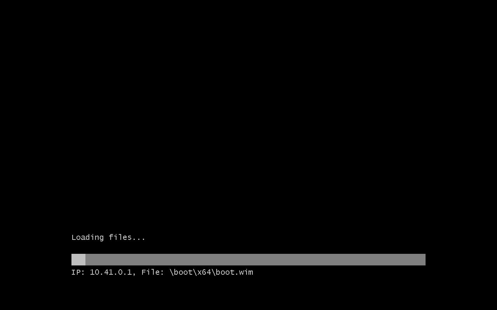
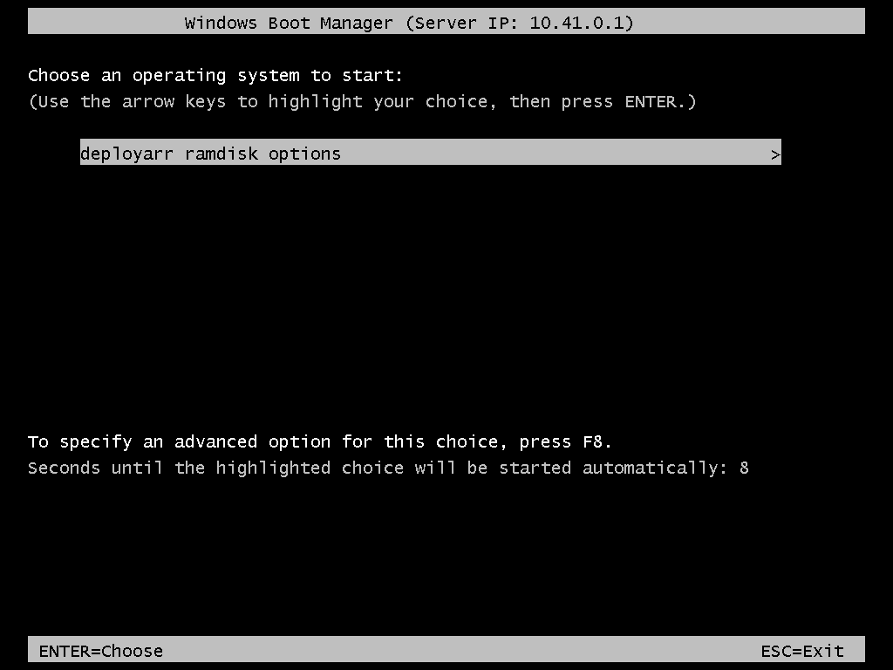
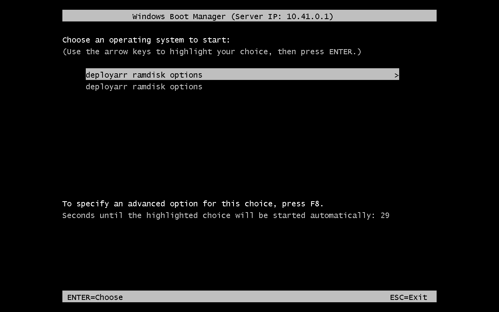
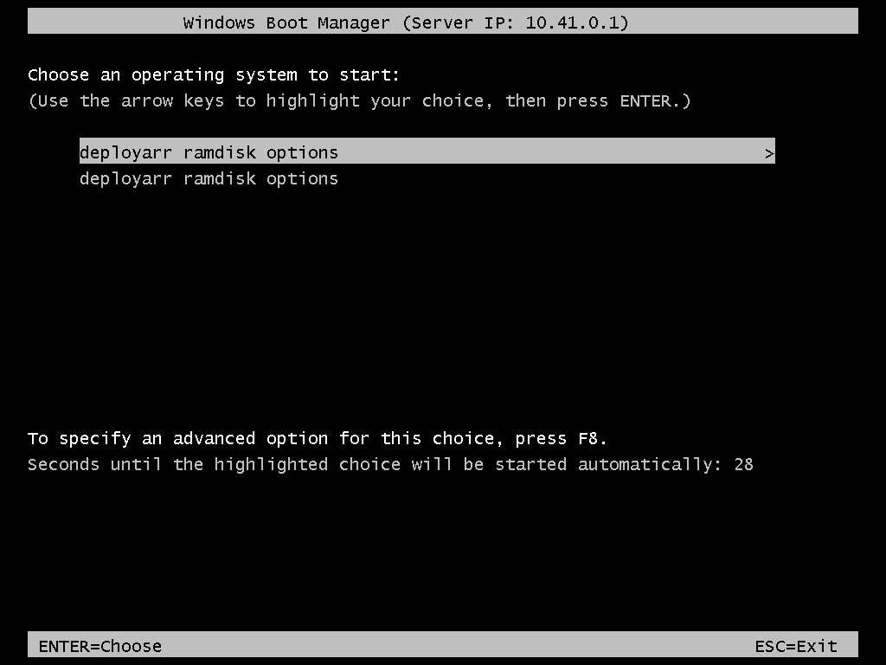
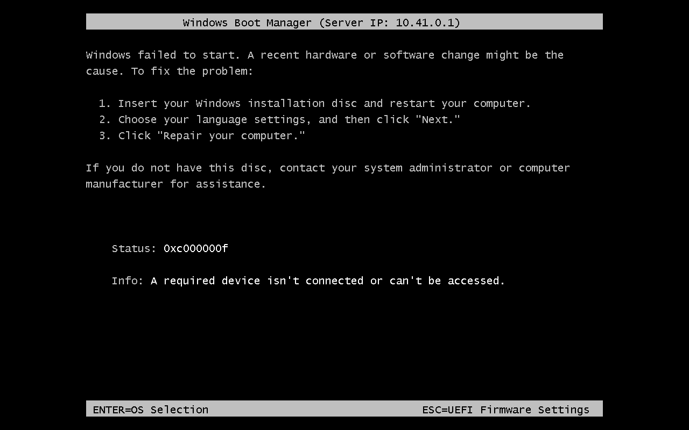
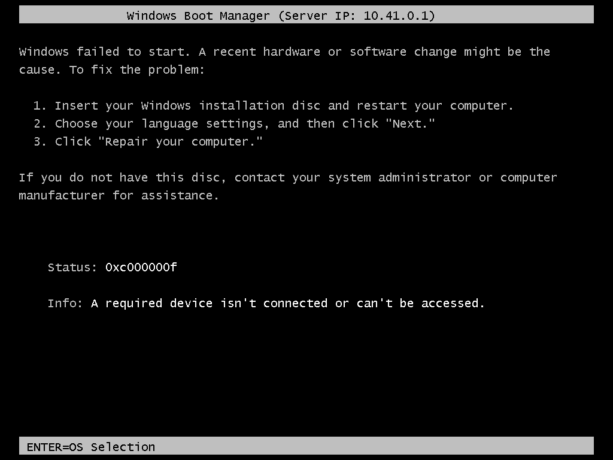

# Boot fonts for a boot locale, the boot menu, and an error screen in the PXE lab

This page records which boot fonts each boot manager requests in three cases: its BCD store sets a non-English boot locale, its store turns on the boot menu, or the boot ends on an error screen. It is for [#346](https://github.com/Tsukidy/deployarr/issues/346). The [boot fonts page](boot-fonts.md#not-covered), for [#222](https://github.com/Tsukidy/deployarr/issues/222), left fonts other than `wgl4_boot.ttf` open. Each run serves the `Fonts` set at `\boot\fonts`. The `uefi2023` VM boots the 2023-signed `bootmgfw.efi`, and the `bios` VM boots `pxeboot.n12` and then the 2011-signed `bootmgr.exe`. Each run serves one of four BCD store variants. The runs are from 2026-11-20, on the lab host. The results change nothing in the design ([What changes in deployarr](#what-changes-in-deployarr)).

Paths in code font that start with `runs/`, `captures/`, `plans/`, or `tftp/` are relative to `~/deployarr-lab` on the lab host. They are outside the repository.

## Result

| Run | VM | Store variant | Font requests | Other requests the variant caused | Screen | WinPE |
| --- | --- | --- | --- | --- | --- | --- |
| 1 | `uefi2023` | `locale-ja-JP` | `\boot\fonts\wgl4_boot.ttf` only, complete | `\boot\x64\ja-JP\bootmgfw.efi.MUI`, File not found | `Loading files...` in English, same text pixels as #222 | Starts |
| 2 | `bios` | `locale-ja-JP` | `\boot\fonts\wgl4_boot.ttf` only, complete | `\boot\ja-JP\bootmgr.EXE.MUI`, File not found | `Loading files...` in English, same text pixels as #222 | Starts |
| 3 | `uefi2023` | `menu` | `\boot\fonts\wgl4_boot.ttf` only, complete | None | Text boot menu, one entry, 10 s countdown | Starts |
| 4 | `bios` | `menu` | `\boot\fonts\wgl4_boot.ttf` only, complete | None | Text boot menu, one entry, 10 s countdown | Starts |
| 5 | `uefi2023` | `two-entries` | `\boot\fonts\wgl4_boot.ttf` only, complete | None | Text boot menu, two entries, 30 s countdown | Starts |
| 6 | `bios` | `two-entries` | `\boot\fonts\wgl4_boot.ttf` only, complete | None | Text boot menu, two entries, 30 s countdown | Starts |
| 7 | `uefi2023` | `missing-sdi` | `\boot\fonts\wgl4_boot.ttf` only, complete | `\boot\missing.sdi`, File not found | Error, `Status: 0xc000000f` | Does not start |
| 8 | `bios` | `missing-sdi` | `\boot\fonts\wgl4_boot.ttf` only, complete | `\boot\missing.sdi`, File not found | Error, `Status: 0xc000000f` | Does not start |

The font requests, the other requests, and their outcomes come from each run's `derived/requests.txt`. Each `wgl4_boot.ttf` served was the `Fonts` file, 50096 bytes, SHA-256 `23872d2eba60bbb3bd2585e925c4b48769fb6bb0cfa7f4a6ba4e8f03bcaf2c35`.

- No run requested a font other than `wgl4_boot.ttf`. `runs/346/fonts/summary.txt` lists `fonts_requested=wgl4_boot.ttf other_fonts=none` for all eight runs and ends with `NO-OTHER-FONT`.
- So no `Fonts_EX` control ran, and no other font was compared table by table. #346 asks for a control only for a variant that makes the `uefi2023` VM request another font ([Owner input on #346](https://github.com/Tsukidy/deployarr/issues/346#issuecomment-7046495135)). Runs 1, 3, 5, and 7 each print `CONTROL=not-needed`.
- With the `ja-JP` locale, each boot manager asked for a `ja-JP` `.MUI` file. `uefi2023` asked for `\boot\x64\ja-JP\bootmgfw.efi.MUI`, beside its own file `\boot\x64\bootmgfw.efi`. `bios` loaded `boot\x64\bootmgr.exe` but asked for `\boot\ja-JP\bootmgr.EXE.MUI`, under `\boot` and not under `\boot\x64`. The roots hold no such file, as the owner chose. Each boot manager then drew the same English `Loading files...` text as in #222, pixel for pixel, and started WinPE.
- The menu variants showed a text menu with a countdown, then booted the default entry. Every entry in the four menu runs reads `deployarr ramdisk options`. That is the description of the store's `{ramdiskoptions}` object, not of the loader ([What the menu entries show](#what-the-menu-entries-show)).
- The `missing-sdi` variant made each boot manager request `\boot\missing.sdi`, get File not found, load `wgl4_boot.ttf`, and show an error screen. No `boot.wim` transfer followed.
- Run 7 ended when QEMU exited with code 0 before the run script stopped it, about 60 s after the error. That QEMU exited on its own, through a guest power-off, is inferred, and a `quit` from another monitor client cannot be ruled out ([How run 7 ended](#how-run-7-ended)). The plan listed that end as a stop before the run. The owner accepted it as a result after the run ([Owner input on #346](https://github.com/Tsukidy/deployarr/issues/346#issuecomment-7049690422)).

## The store variants

`runs/346/tools/build_stores.sh` built the stores on 2026-11-20 at 17:50:55 UTC into `runs/346/stores/`, and printed `BUILD-OK` (`runs/346/stores/build.txt`). It copied the lab's default stores `tftp/2011/boot/uefi.bcd` and `tftp/2011/boot/bios.bcd` to `runs/346/stores/orig/`, and checked their hashes against `tftp/manifest.txt`. `build_variants.py` then copied a source store for each variant and ran `hivexsh -w` on the copy, with the commands in `runs/346/stores/<store>.hivexsh` on standard input. `hivexsh` is from `libhivex-bin` 1.3.24-2.1build2. No source store was opened for writing.

| Store | Bytes | SHA-256 | Change against the source store |
| --- | --- | --- | --- |
| `uefi-locale-ja-JP.bcd` | 16384 | `3fd7b896d5802780d4adaa3b5491de19f55a0edd2b83246d483abfeaa714743a` | Adds `{bootmgr}` element `12000005` = `ja-JP` |
| `bios-locale-ja-JP.bcd` | 16384 | `728dd1f810422b6459b3f31b3577f8eae18e44b7bccb34c4c286abdbc1b0b4da` | The same |
| `uefi-menu.bcd` | 16384 | `abd9cd06b45eb4dc2e30e2c3f2ef20a7c628eb8f956cfbd9236c9b70bb403d61` | Adds `{bootmgr}` element `26000020` = `01`, and sets `25000004` from 30 to 10 |
| `bios-menu.bcd` | 16384 | `88f84a19444696fb2c32d428a3945853b97d9be81eb6d2707a6f252c3173ea59` | The same |
| `uefi-two-entries.bcd` | 16384 | `565467db59370a212312c1a745317b699c64d34e19194b2265b1064cede4b14e` | Adds a second loader object `{7b0e1d6a-5c11-4f3e-9a52-2d3f6a8c0e11}`, described `deployarr WinPE 2`, and lists both loaders in `{bootmgr}` element `24000001` |
| `bios-two-entries.bcd` | 16384 | `4f2d9ef6c7d9da1b380fa5fde9289aac5ae030cef20353dd548d630b5ba0c785` | The same, with the loader `{7b0e1d6a-5c11-4f3e-9a52-2d3f6a8c0e12}` |
| `uefi-missing-sdi.bcd` | 16384 | `bef47eeb36033baa0973a6053b0bf53c67d8e2f815097627a2a09a236dc85f74` | Sets `{ramdiskoptions}` element `32000004` from `\boot\boot.sdi` to `\boot\missing.sdi` |
| `bios-missing-sdi.bcd` | 16384 | `119558b95035e5555d3a38019ac2c86b7038fb0e678ee0ed92333dfc1a5b7570` | The same |

The sizes and hashes come from `runs/346/stores/used.txt` and `stores.sha256`. The source stores are `uefi.bcd`, 12288 bytes, `c0164082153aa4eeb826b68d9e3acb4ad815fbf64b8dc1b8a51ef0f02d010224`, and `bios.bcd`, 12288 bytes, `5682186b6906955f5f5e610aee7dc9eb66e3d5314d31141c5ff9b1a0750e7b0d`. `{bootmgr}` is `{9dea862c-5cdd-4e70-acc1-f32b344d4795}`, and `{ramdiskoptions}` is `{ae5534e0-a924-466c-b836-758539a3ee3a}`.

- Each of the eight variants this page uses grew from 12288 to 16384 bytes, because hivex appended a hive bin. The two unused `no-fontpath` variants only delete an element, and stayed at 12288 bytes (`runs/346/stores/stat.txt`). `regf_check.py` read each base block. Each has the signature `regf`, both sequence numbers 36 (35 in the sources), version 1.3, a hive-bins size of 12288, and a correct header checksum (`runs/346/stores/regf.txt`, `verdict=CLEAN`).
- A normalized `hivexml` diff against the source shows only the change in the table (`runs/346/stores/diff/*.hivexml.diff`).
- The build is deterministic. All 22 variants that the script builds match byte for byte the build that the plan's store research made earlier in `plans/346/scratch/variants/`, whose hashes are in `plans/346/scratch/variants.sha256` (`runs/346/stores/reader-compare.txt`, `SAME-AS-READER-BUILD`). This page uses 8 of them.
- No earlier lab run served a store that hivex grew. The owner allowed one diagnostic run with a grown store that changes no element, if run 1 failed before any request under `\boot\fonts\` ([Owner input on #346](https://github.com/Tsukidy/deployarr/issues/346#issuecomment-7047693124)). Run 1 and every later run requested `\boot\fonts\wgl4_boot.ttf` after the store, so that run was not needed and did not run.

### Element IDs

The element names come from Microsoft's BCD element type pages, [`BcdBootMgrElementTypes`](https://learn.microsoft.com/en-us/previous-versions/windows/desktop/bcd/bcdbootmgrelementtypes), [`BcdLibraryElementTypes`](https://learn.microsoft.com/en-us/previous-versions/windows/desktop/bcd/bcdlibraryelementtypes), and, for `BootMenuPolicy`, [`BcdOSLoaderElementTypes`](https://learn.microsoft.com/en-us/previous-versions/windows/desktop/bcd/bcdosloaderelementtypes), as the plan's research recorded them (`plans/346/understand.json`):

| Element | Name | Object | What the page says |
| --- | --- | --- | --- |
| `12000005` | `PreferredLocale` | `{bootmgr}` | "Preferred locale, in RFC 3066 format" |
| `26000020` | `DisplayBootMenu` | `{bootmgr}` | "Forces the display of the legacy boot menu, regardless of the number of OS entries … and their BcdOSLoaderInteger_BootMenuPolicy", with the ellipsis as the research recorded it |
| `25000004` | `Timeout` | `{bootmgr}` | Not quoted |
| `24000001` | `DisplayOrder` | `{bootmgr}` | Not quoted |
| `1200004a` | `FontPath` | `{bootmgr}` | "Overrides the default location of the boot fonts". The source stores set it to `\boot\fonts`. |
| `250000c2` | `BootMenuPolicy` | A loader | Not quoted. The research recorded legacy as 0, standard as 1, and legacy as the API default. |

- That `bcdedit`'s names `locale` and `displaybootmenu` write `12000005` and `26000020` is inferred. The Microsoft pages that the plan's research read do not say so.
- `12000004` holds each object's description, and `32000004` holds the SDI path of `{ramdiskoptions}` (inferred from the values in the source stores: `deployarr boot manager` on `{bootmgr}`, and `\boot\boot.sdi` on `{ramdiskoptions}`). The research did not cite a Microsoft page for these two.
- No variant sets `250000c2` (`BootMenuPolicy`), on `{bootmgr}` or on any loader. The source stores have no `12000005`, `26000020`, or `250000c2`. `runs/346/derived-page/bootmgr-elements.txt` lists the `{bootmgr}` elements of the two source stores and all eight variants, and `loader-250000c2.txt` shows `250000c2` absent on every loader object of the same ten stores.

### The command files

The `locale-ja-JP` command file, the same for both stores, 127 bytes, SHA-256 `84be5ab593bd1ecb8931cabea68d3b157f3fae781d71a8b877c21e4f367a40c0`:

```text
cd \Objects\{9dea862c-5cdd-4e70-acc1-f32b344d4795}\Elements
add 12000005
cd 12000005
setval 1
Element
string:ja-JP
commit
exit
```

The `menu` command file, the same for both stores, 242 bytes, SHA-256 `75cbd12654f5a7ada301dbdf482425bea0d5a199690a6ec2e4f6c7372a7feda6`:

```text
cd \Objects\{9dea862c-5cdd-4e70-acc1-f32b344d4795}\Elements
add 26000020
cd 26000020
setval 1
Element
hex:3:01
cd \Objects\{9dea862c-5cdd-4e70-acc1-f32b344d4795}\Elements
cd 25000004
setval 1
Element
hex:3:0a,00,00,00,00,00,00,00
commit
exit
```

The `missing-sdi` command file, the same for both stores, 126 bytes, SHA-256 `2b00939e68c908939fa33da2140c3a40155624f69cc82104120c4ba3be1f39b0`:

```text
cd \Objects\{ae5534e0-a924-466c-b836-758539a3ee3a}\Elements
cd 32000004
setval 1
Element
string:\boot\missing.sdi
commit
exit
```

The `two-entries` command files are 2654 bytes each. `uefi-two-entries.bcd.hivexsh` has the SHA-256 `43e6b3bd279aa04c1d620123e94286b758da1b10bb65da1fcc332c26111bd5ef`, and `bios-two-entries.bcd.hivexsh` has `269eef34c0f499bc4b16726feab0c41e563153d0fbceb43377aba8b93aaa2bf5`. They copy the first loader's elements into a new loader object. The full files stay on the lab host, at `runs/346/stores/uefi-two-entries.bcd.hivexsh` and `runs/346/stores/bios-two-entries.bcd.hivexsh`. This is their structure for the `uefi` store, with each long `hex:` value cut to its length (`runs/346/derived-page/two-entries-structure.txt`). Each `setval 1` and `Element` line pair, and the closing `commit` and `exit`, are left out:

```text
cd \Objects
add {7b0e1d6a-5c11-4f3e-9a52-2d3f6a8c0e11}
  add Description       Type   dword:0x10200003
  add Elements
  add 11000001          hex:3  178 bytes, copied from the first loader
  add 12000002          string:\windows\system32\boot\winload.efi
  add 12000004          string:deployarr WinPE 2
  add 21000001          hex:3  178 bytes, copied from the first loader
  add 22000002          string:\windows
  add 26000010          hex:3:01
  add 26000022          hex:3:01
{bootmgr} 24000001      hex:7  158 bytes, both loader GUIDs
```

The `bios` file adds `{7b0e1d6a-5c11-4f3e-9a52-2d3f6a8c0e12}` with `\windows\system32\boot\winload.exe`, and copies its device values from the `bios` loader. In each store, every element of the second loader holds the same value as the first loader's, except the description `12000004` (`runs/346/derived-page/second-loader-copy.txt`). In both stores, `{bootmgr}` element `23000003` still names the first loader, and `25000004` stays 30 (`bootmgr-elements.txt`).

### What the menu entries show

The menus in runs 3 to 6 show `deployarr ramdisk options` for every entry ([Screens](#screens)). The stores hold these descriptions in element `12000004` (`runs/346/derived-page/store-descriptions.txt`, which prints the object types in decimal):

| Object | Object type | Description |
| --- | --- | --- |
| `{bootmgr}` | `0x10100002` | `deployarr boot manager` |
| The loader, `{7b0e1d6a-5c11-4f3e-9a52-2d3f6a8c0e01}` (`uefi`) or `...0e02` (`bios`) | `0x10200003` | `deployarr WinPE` |
| The second loader in `two-entries`, `...0e11` or `...0e12` | `0x10200003` | `deployarr WinPE 2` |
| `{ramdiskoptions}`, `{ae5534e0-a924-466c-b836-758539a3ee3a}` | `0x30000000` | `deployarr ramdisk options` |

The source stores and all eight variants hold the same descriptions. Only the `two-entries` stores add the second loader. Each loader's elements `11000001` and `21000001` are 178 bytes long, and each starts with the GUID of `{ramdiskoptions}`, at offset 0 (`runs/346/derived-page/device-refs.txt`). The boot managers showed the description of the object that the loader's device names, and not the loader's own (inferred, [What is inferred](#what-is-inferred)). These runs do not show why.

## Setup

| Item | Value |
| --- | --- |
| Lab host | Ubuntu 26.04.1 LTS, kernel `7.0.0-43-generic`, AMD Ryzen 7 7700X, KVM, `nproc` 6, 15428 MiB of memory with 11894 MiB free and 14151 MiB available before the runs, from `free -m` (`runs/346/host/env-before.txt`). Every run's `env.txt` gives the same boot time, 2026-11-18 20:40:58, so the host did not restart during the runs. |
| Lab scripts and PXE prototype | `tools/lab/` and `tools/pxe-prototype/` from the checkout `~/deployarr-lab/main` at `dbea61c` (`dbea61cae2f238f9ec2974a172e3a05ad720950e`), with no local changes (`env-before.txt`). Since #222's `3fc0d3f`, three of these files changed: `tools/lab/lab.conf`, `tools/pxe-prototype/README.md`, and `tools/lab/network.sh`. The `network.sh` change, `ee7fe09` from #353, adds the opt-in NAT uplink, which was off in every run, as the Network row shows (`runs/346/derived-page/lab-scripts-diff.txt`). `env-before.txt` gives the diff of `vm.sh`, `lab.conf`, and `tools/pxe-prototype/` only, and the SHA-256 of `network.sh`. The working checkout was at `8102c76` on `lab-346-other-boot-fonts`. |
| Network | `br-lab` at `10.41.0.1/24`. dnsmasq runs at `10.41.0.2` in the namespace `deployarr-lab-dhcp`. The uplink was off. `host/idle-preflight.txt` and each run's `preflight.txt` hold `The uplink is off`. |
| Chain | `--chain single`, with the default store paths. On `uefi2023`, each ACK named `boot\x64\bootmgfw.efi` and option 252 = `boot\uefi.bcd`. On `bios`, each ACK named `boot\x64\pxeboot.n12` and option 252 = `boot\bios.bcd`. Each run's root held its variant at that path. |
| `uefi2023` VM | As in [Setup](boot-fonts.md#setup) of the boot fonts page (`qemu-cmdline.txt`). `q35` with SMM, `OVMF_CODE_4M.ms.fd`, Secure Boot on, TPM 2.0 through `swtpm`, a virtio-net card with no option ROM, MAC `52:54:00:41:00:12`, 2 vCPUs, 4 GB. |
| `bios` VM | `pc` with `smbios-entry-point-type=32`, SeaBIOS, QEMU's `e1000` card with its iPXE ROM, MAC `52:54:00:41:00:21`, 2 vCPUs, 4 GB (`qemu-cmdline.txt`) |

Each run gave `vm.sh` its own `LAB_DIR`, so the VM's folder was new, under `runs/346/<run>/`. The runs did not touch `~/deployarr-lab/bios` or `~/deployarr-lab/uefi2023` (`host/labvm-before.txt` and `labvm-after.txt` are the same). On `uefi2023`, the run script copied `~/deployarr-lab/OVMF_VARS_4M.win23.fd` to the VM's `vars.fd` and checked the copy (`vmfolder.txt`, `vars.fd-is-template-copy`). After each `uefi2023` run, `derived/secure-boot.txt` shows `SecureBootEnable    : bool: ON` for its `vars.fd`.

| Run | VM start | Stop rule | Stop | Last screendump |
| --- | --- | --- | --- | --- |
| 1, `uefi2023-locale-ja-JP` | 18:41:04.615 | `loader+30` | 18:42:32.862 | `0088.png`, 18:42:32.855 |
| 2, `bios-locale-ja-JP` | 18:43:31.830 | `loader+30` | 18:45:42.336 | `0129.png`, 18:45:42.330 |
| 3, `uefi2023-menu` | 18:46:34.412 | `loader+30` | 18:48:13.057 | `0098.png`, 18:48:13.051 |
| 4, `bios-menu` | 18:49:08.395 | `loader+30` | 18:51:26.136 | `0136.png`, 18:51:26.130 |
| 5, `uefi2023-two-entries` | 18:52:15.176 | `loader+30` | 18:54:12.699 | `0116.png`, 18:54:12.694 |
| 6, `bios-two-entries` | 18:55:10.519 | `loader+30` | 18:57:48.081 | `0155.png`, 18:57:48.075 |
| 7, `uefi2023-missing-sdi` | 18:58:39.731 | `vm-ended-early` | 18:59:47.929 | `0066.png`, 18:59:46.917 |
| 8, `bios-missing-sdi` | 20:19:24.567 | `error-quiet+60` | 20:20:33.637 | `0069.png`, 20:20:33.631 |

The VM start, stop rule, and stop come from each run's `times.txt`. The last screendump is the `LAST` line of `derived/selected.txt`. The run script wrote the wall clock and `/proc/uptime` at each step. Run 8 started after the owner's answer on run 7, posted at 20:19:18 UTC.

The stop rules, from `runs/346/tools/run.sh`:

The script checks the rules once on each pass of its loop, about once a second, with bash's whole-second `SECONDS` counter. So a rule fires up to about 1 s before or after its nominal time. For `error-quiet+60`, that is 59 to 61 s after the events (`plans/346/plan.md`, Run 7 outcome).

- `loader+30` stops a run 30 s after the run script first sees `UnlockToken` in the prototype's log, as #222 did.
- `error-quiet+60` stops a `missing-sdi` run when `\boot\missing.sdi` was requested and no `UnlockToken` came, once the counter shows 60 s since the run script saw the request and 60 s since it saw the last new log line.
- `cap+240` and `hard-cap+300` stop a run 240 s or 300 s after the loop starts, which is after QEMU starts and a little after the `vm-start` stamp. Neither fired.
- `vm-ended-early` is the stamp the script writes when QEMU exits before any rule fires.

### The TFTP roots

`runs/346/tools/build_root.sh <run>` built each root at `runs/346/roots/<run>`, from 18:40:55 to 18:40:58 UTC, before the runs. It logged each command in `runs/346/roots/<run>-build.txt`. These are the commands for run 1, from `build_root.sh:69-76`:

```bash
cp -al /home/user/deployarr-lab/tftp/2023 /home/user/deployarr-lab/runs/346/roots/uefi2023-locale-ja-JP
rm -r /home/user/deployarr-lab/runs/346/roots/uefi2023-locale-ja-JP/boot/fonts
cp -al /home/user/deployarr-lab/tftp/2011/boot/fonts /home/user/deployarr-lab/runs/346/roots/uefi2023-locale-ja-JP/boot/fonts
rm /home/user/deployarr-lab/runs/346/roots/uefi2023-locale-ja-JP/boot/uefi.bcd
cp /home/user/deployarr-lab/runs/346/stores/uefi-locale-ja-JP.bcd /home/user/deployarr-lab/runs/346/roots/uefi2023-locale-ja-JP/boot/uefi.bcd
chmod 0444 /home/user/deployarr-lab/runs/346/roots/uefi2023-locale-ja-JP/boot/uefi.bcd
```

- Each `uefi2023` root is the `tftp/2023` root made of hard links, with `boot/fonts` replaced by links to the `tftp/2011` set, the `Fonts` set. This is how [Run 2's TFTP root](boot-fonts.md#run-2s-tftp-root) of the boot fonts page was made. Then the variant replaces `boot/uefi.bcd`.
- Each `bios` root is `cp -al` of `tftp/2011`, with the variant in place of `boot/bios.bcd`. The other three commands are the same as above.
- `rm` removes only the root's link. The source store kept its inode, link count, and size. Each build file logs them before and after.
- `chmod` touches only the new copy of the store, never a link.

Each of the eight build files ends with these lines (`grep -E '^(files=|same-tree|ROOT-)' runs/346/roots/*-build.txt`):

```text
files=31 links=30 variants=1 not_a_link=0
same-tree
ROOT-OK
```

- Each file gets one line in the build file. `LINK <inode> <links> <path> = <source>` shows that the file has the inode of its source in the lab root. The 16 fonts link to `tftp/2011/boot/fonts`, and the other 14 files to the base root. `VARIANT` marks the store, with one link and the variant's SHA-256.
- `same-tree` means that the root lists the same paths as its base root.
- The build file also gives the size and SHA-256 of every file but `boot.wim`, whose inode is in the link lines.

After the last run, `rm -r` removed the roots. It only unlinks. `runs/346/host/roots-removed.txt`, written at 20:21:24 UTC, lists the eight roots. `runs/346/host/links-before.txt`, from 18:40:51 UTC, and `links-after.txt`, from 20:21:25 UTC (`runs/346/derived-page/roots-removed-stat.txt`), hold the inode and link count of every file in `tftp/`. The two files are the same, so every link count came back and no inode changed (`runs/346/derived-page/host-compare.txt`, `LINKS-SAME`). The build files and the variant stores stay on the lab host.

## Versions

| Item | Version or SHA-256 |
| --- | --- |
| `qemu-system-x86` | 1:10.2.1+ds-1ubuntu3.3 |
| `ovmf` | 2025.11-3ubuntu7.3 |
| `seabios` | 1.17.0-1ubuntu1 |
| `ipxe-qemu` | 1.21.1+git-20250829.969ce2c55+dfsg-3ubuntu2 |
| `swtpm` | 0.10.1+ds-1ubuntu3 |
| `dnsmasq-base` | 2.92-1ubuntu0.5 |
| `tshark`, `wireshark-common` | 4.6.4-1 |
| `libhivex-bin` | 1.3.24-2.1build2 |
| `osslsigncode` | 2.13-1 |
| Python | 3.14.4 |
| OpenSSL | 3.5.5 |
| `timeout` | uutils coreutils 0.10.0 |
| `OVMF_CODE_4M.ms.fd` | `33c413a04e9edf512c504e9b0accbcec4d009d406bca761cc0b8eacc93da60b6` |
| `OVMF_VARS_4M.win23.fd`, the template | `16b2478518659d692b85cd6e400b23a28f924ec95a63da86e904d8e4792462d3` |
| SeaBIOS `bios-256k.bin` | `e26615f9ad430328f49ca105e570b2dc4490a08a34ea73d27cae8b809a30ee06` |
| `efi-e1000.rom`, the `bios` VM's `e1000` ROM | `73e68ac2bde85830847d087724f848f286d3691ae2440100a5a13e7337100c40` |

The package versions come from `runs/346/host/versions-before.txt`, and the firmware hashes, except the ROM's, from `firmware-before.txt`. The lab host recorded both before the first run and again after the last, and the records are the same (`runs/346/derived-page/host-compare.txt`). The `timeout` version is in no host record. It comes from each run's `runs/346/<run>/env.txt`, which gives the same version in all eight runs, so the before and after comparison does not cover it. `tftp-before.txt` and `tftp-after.txt` both start with `MANIFEST-OK`.

`firmware-before.txt` records `/usr/share/qemu/pxe-e1000.rom`, but QEMU 10.2.1 does not load that file for the `e1000` card. [Versions](ipxe-option-97.md#versions) of the iPXE option 97 page records from `info qtree` that the card's `romfile` is `efi-e1000.rom`, and that no device names `pxe-e1000.rom`. The `qemu-system-x86_64` binary names `compat-256k-efi-e1000.rom` and no `pxe-e1000` file. Both files are from `ipxe-qemu`, whose version did not change. The ROM's SHA-256 above was taken after the runs, while this page was written (`runs/346/derived-page/e1000-rom.txt`), so the before and after comparison does not cover it.

These are the boot managers and fonts that the runs served. The sizes and SHA-256 come from the `served` lines of each run's `derived/requests.txt`. The issuer and version come from [Versions](boot-fonts.md#versions) of the boot fonts page, which lists the same files with the same SHA-256.

| File | Served in | Bytes | SHA-256 | Issuer | Version |
| --- | --- | --- | --- | --- | --- |
| `boot/x64/pxeboot.n12` | Runs 2, 4, 6, 8 | 25238 | `9e34cbc08fc26902f351889b8c29c80b5f6ec99f1bb44dcf083ba2b988e37267` | Not a PE file | None |
| `boot/x64/bootmgr.exe` | Runs 2, 4, 6, 8 | 814544 | `364c896a4fd4690949d1f7c386332f4f32541b01a05adfc13b7178258571a7ad` | Microsoft Windows Production PCA 2011 | 10.0.26100.9444 |
| `boot/x64/bootmgfw.efi`, from `tftp/2023` | Runs 1, 3, 5, 7 | 3087200 | `25d8869e3c79083ae62c698a9db9030748e3267bd53593357447f3f72761d1f2` | Windows UEFI CA 2023 | 10.0.28000.367 |
| `boot/fonts/wgl4_boot.ttf`, `Fonts` | All eight | 50096 | `23872d2eba60bbb3bd2585e925c4b48769fb6bb0cfa7f4a6ba4e8f03bcaf2c35` | Not a PE file | None |

- Each run served its own variant store, 16384 bytes, with the SHA-256 in [The store variants](#the-store-variants). `store_served=yes` in each `times.txt` and the `served` line show that the store with the variant's hash was the one sent.
- Runs 1 to 6 also served `boot/boot.sdi`, 3170304 bytes, `cd2c00ce027687ce4a8bdc967f26a8ab82f651c9becd703658ba282ec49702bd`, and `boot/x64/boot.wim`, 572691590 bytes. `boot.wim` is a hard link to the lab root's file (the build files) and is WinPE 10.0.26100.9457, as in [Versions](bootmgr-object-type.md#versions) of the `{bootmgr}` object type page.
- Runs 7 and 8 served neither `boot.sdi` nor `boot.wim` in full.

## The `uefi2023` VM

| Event | Run 1, `locale-ja-JP` | Run 3, `menu` | Run 5, `two-entries` | Run 7, `missing-sdi` |
| --- | --- | --- | --- | --- |
| First RRQ, `boot\x64\bootmgfw.efi` | 18:41:11.450, 6.834 s after VM start | 18:46:41.173, 6.761 s | 18:52:22.018, 6.841 s | 18:58:46.511, 6.779 s |
| `\boot\uefi.bcd` complete | 18:41:11.695, 7.079 s | 18:46:41.422, 7.010 s | 18:52:22.257, 7.080 s | 18:58:46.762, 7.030 s |
| `wgl4_boot.ttf` complete | 18:41:12.070, 7.454 s | 18:46:41.792, 7.380 s | 18:52:22.633, 7.456 s | 18:58:47.139, 7.407 s |
| `boot.wim` RRQ with `blksize` | 18:41:12.415, 7.799 s | 18:46:51.531, 17.119 s | 18:52:52.319, 37.142 s | None |
| `boot.wim` complete | 18:42:02.104, 57.488 s | 18:47:41.575, 67.163 s | 18:53:42.167, 86.990 s | None |
| `boot.wim` transfer | 49.689 s | 50.044 s | 49.847 s | None |
| `UnlockToken.pol` RRQ | 18:42:02.254, 57.638 s | 18:47:41.742, 67.330 s | 18:53:42.334, 87.157 s | None |

The times come from the prototype's log, and the VM start from `times.txt` (`runs/346/derived-page/timeline.txt`). `timeline.py` rounds each offset from the VM start to the millisecond. The `boot.wim` transfer times are the log's `seconds=` values, which this table also rounds to the millisecond. The `bios` table below does the same. A completion time is the log's `transfer-finished` line. Each `boot.wim` transfer sent 393333 blocks with no retransmit (`complete-transfers.txt`). The firmware sent one DISCOVER in each run, and WinPE sent no DHCP (`capture_discovers=1`, `winpe_dhcp=0`). [What is inferred](boot-fonts.md#what-is-inferred) of the boot fonts page gives the reason, the virtio-net card that WinPE has no driver for (inferred).

#222's run 2, the same VM with `Fonts`, made 32 TFTP requests ([The `uefi2023` VM](boot-fonts.md#the-uefi2023-vm)). Each run's `derived/rrq-diff-222.txt` compares its requests with that run's, file for file and option for option.

In each run, the first two requests were `boot\x64\bootmgfw.efi`, and the first of them ended `User aborted the transfer`. Then came `\boot\x64\BCD` (File not found) and the store twice. The first store request ended `0 TFTP Aborted`. After the store came 16 requests for policy files under `\EFI\Microsoft\Boot\`, each File not found, as in #222. Then came `\boot\x64\bootmgfw.efi` twice more, and `\EFI\Microsoft\Boot\boot.stl` and `\boot\x64\boot.stl`, both File not found.

### Run 1, `locale-ja-JP`

- 33 requests (`derived/requests.txt`). The one request that #222's run 2 did not make is RRQ 22, `\boot\x64\ja-JP\bootmgfw.efi.MUI` with `tsize=0`, at 18:41:11.792, File not found. It came after the 16 policy requests and before the boot manager requested itself again. The other 32 requests match #222's, in order (`rrq-diff-222.txt` holds only this line).
- RRQs 27 and 28 probed `\boot\x64\boot.wim` and `\boot\boot.sdi` with `tsize=0`, and each ended `0 TFTP Aborted`. RRQ 29 asked for `\boot\fonts\wgl4_boot.ttf` with `tsize=0` and ended `0 TFTP Aborted`. RRQ 30 asked again with `tsize=0,blksize=1456`. It completed, 35 blocks in 0.005 s.
- The committed frame, `0011.png` at 18:41:14.334, shows `Loading files...`, a progress bar, and `IP: 10.41.0.1, File: \boot\x64\boot.wim`, in English.
- `derived/compare-222.txt` compares it with #222's committed `uefi2023` frame. Both text bands have the same SHA-256 as #222's, and only the bar differs. It prints `text bands equal`.
- The last screendump, `0088.png` at 18:42:32.855, shows the window `Administrator: X:\windows\system32\cmd.exe` at a prompt after `wpeinit`. It is the same file as #222's last frame of run 2 (`runs/346/derived-page/last-frames.txt`, `last-frames-222.txt`). WinPE started (`winpe-read.txt`).

### Run 3, `menu`

- 32 requests, the same files and options as #222's run 2. Only the order differs. The `boot.wim` and `boot.sdi` probes, RRQs 28 and 29, came after the font, at 18:46:51.226, and not before it (`rrq-diff-222.txt`).
- The font completed at 18:46:41.792. Then the log has no TFTP line for 9.434 s, until the `boot.wim` probe (`derived/selected.txt`).
- In that gap, the screen shows a menu. The committed frame, `0010.png` at 18:46:43.075, shows `Windows Boot Manager (Server IP: 10.41.0.1)`, `Choose an operating system to start:`, one highlighted entry, `deployarr ramdisk options`, and `Seconds until the highlighted choice will be started automatically: 9`. The footer reads `ENTER=Choose` and `ESC=Exit`. Frame `0008.png` shows the countdown at 10 and frame `0017.png` at 1 (`runs/346/derived-page/frame-reads.txt`). `frames.txt` gives each of frames `0010.png` to `0017.png` its own set of text bands.
- Frame `0018.png` shows `Loading files...` with `File: \boot\boot.sdi`. The committed `boot.wim` frame, `0020.png` at 18:46:53.540, is the same file as #222's committed `uefi2023` frame, SHA-256 `3c9ca848965dd0a2e29324076a70971d8cd140cbde3f93e74ab626e1f12ca687`.
- No key was sent. The default entry booted after the countdown. The last screendump, `0098.png` at 18:48:13.051, is the same `cmd.exe` frame as run 1's. WinPE started.

### Run 5, `two-entries`

- 32 requests, the same as run 3 in order and options (`rrq-diff-222.txt` is the same as run 3's).
- The log has no TFTP line for 29.367 s after the font, which completed at 18:52:22.633.
- In that gap, the screen shows the same menu with two entries, both `deployarr ramdisk options`. The first is highlighted. The committed frame, `0010.png` at 18:52:23.842, shows the countdown at 29. Frame `0008.png` shows 30 and frame `0036.png` shows 2.
- The highlighted default entry booted after the countdown. That it was the first loader, which `{bootmgr}` element `23000003` names, is inferred. Both loaders hold the same elements but the description, so no file shows which one started. The last screendump, `0116.png` at 18:54:12.694, is the same `cmd.exe` frame as run 1's. WinPE started.

### Run 7, `missing-sdi`

- 29 requests. RRQs 1 to 25 match #222's run 2. RRQ 26 probed `\boot\x64\boot.wim` with `tsize=0` and ended `0 TFTP Aborted`. RRQ 27, at 18:58:47.133, asked for `\boot\missing.sdi`, where #222 asked for `\boot\boot.sdi`. It got File not found. RRQs 28 and 29 asked for `\boot\fonts\wgl4_boot.ttf`. RRQ 29 completed, 35 blocks in 0.005 s. #222's last three requests, for `boot.sdi`, `boot.wim`, and `UnlockToken.pol`, did not come (`rrq-diff-222.txt`).
- The last line of the prototype's log is that font transfer, at 18:58:47.139. The full capture's last packet is the font's last ACK, frame 2768, although `dumpcap` ran until 18:59:51. The capture holds one DISCOVER from the VM (`derived/dhcp-client.tsv`, `capture_discovers=1`). So the VM sent no DHCP and no TFTP request in its last 60 s. The capture filter drops TFTP DATA packets and IP fragments, but it keeps DHCP packets and TFTP requests, so the capture would hold any such packet.
- Frames `0008.png` to `0066.png`, 18:58:47.299 to 18:59:46.917, are 59 frames with the same set of text bands (`frames.txt`). Each is the same PNG file, SHA-256 `51eb6f28bd3a731db35f06f2d48cc0c1f937e6f941502ce5166632436d4d6514` (`runs/346/derived-page/error-frames.txt`). The screen shows `Windows Boot Manager (Server IP: 10.41.0.1)`, `Windows failed to start. A recent hardware or software change might be the cause.`, three repair steps, `Status: 0xc000000f`, and `Info: A required device isn't connected or can't be accessed.` The footer reads `ENTER=OS Selection` and `ESC=UEFI Firmware Settings`. No countdown shows.
- The committed `hold` frame, `0010.png`, and `last-screen` frame, `0066.png`, are the same image. The fixed selection rule picks both, so the repository holds both.
- WinPE did not start. There was no `boot.wim` transfer and no `UnlockToken.pol` request, and the last screendump is the error screen (`winpe-read.txt`).

#### How run 7 ended

- `times.txt` has `error-request` at 18:58:47.353, then `vm-ended-early` at 18:59:47.929 and `stop-rule=vm-ended-early`. QEMU exited with `qemu_exit=0` before `error-quiet+60` fired, and before the run script sent any stop. That it exited on its own is inferred, as the points below say.
- The last screendump returned at 18:59:46.923 (`shots/shots.tsv`, row 66). So QEMU ended in a 1.006 s window, 59.790 to 60.796 s after the `missing.sdi` RRQ (`runs/346/derived-page/missing-sdi-end.txt`). That window has no frame, so the screen in the last second is not known.
- `qemu_exit=0` alone does not show a guest power-off. QEMU also exits 0 after HMP `quit`, as in runs 1 to 6, and after a signal from another process. After a signal it prints `terminating on signal`, which would be in `vm.out`. Run 7's `vm.out` has no such line, and neither has any other run's (`grep -c 'terminating on signal' runs/346/*/vm.out` gives 0 for each). A `quit` from another client on the run's own `mon.sock` would leave no line, and the files cannot rule it out (`plans/346/plan.md`, section Run 7 outcome).
- `qemu-cmdline.txt` has neither `-no-reboot` nor `-no-shutdown`, so a guest reset would have started PXE again. None came.
- `vmstate.txt` gives `uefi2023/tpm/tpm2-00.permall` the modification time 18:59:47.543, inside the window. This only shows that QEMU and `swtpm` ended in the window. Runs 1, 3, and 5, which the run script ended with HMP `quit`, also wrote the file at their stop, at 18:42:32.871, 18:48:13.066, and 18:54:12.710 (their `vmstate.txt`). So the write is not evidence of a guest power-off.
- From the exit code, the `vm.out` with no signal line, and the missing reset and DISCOVER, a guest power-off is inferred. Its cause is not known. `serial.log` ends with OVMF's `BdsDxe: starting Boot0003`, and shows nothing after the boot manager took over.

#### Run 7 outcome

Before run 7, the plan listed `vm-ended-early` as a stop for every run (`plans/346/plan.md`, Expected and unexpected outcomes). After run 7, the main conversation recorded the run as an unexpected outcome (`runs/346/uefi2023-missing-sdi/unexpected.txt`) and did not run it again. The owner then accepted run 7 as a result with no rerun ([Owner input on #346](https://github.com/Tsukidy/deployarr/issues/346#issuecomment-7049690422)). Run 8 ended by `error-quiet+60`.

The rest of run 7 shows no fault. It has `run_exit=0`, `derive_exit=0`, a `leftovers.txt` that lists no process, and `serial-copied`. `dumpcap` reported 2768 packets received and 0 dropped.

## The `bios` VM

| Event | Run 2, `locale-ja-JP` | Run 4, `menu` | Run 6, `two-entries` | Run 8, `missing-sdi` |
| --- | --- | --- | --- | --- |
| First RRQ, `boot\x64\pxeboot.n12` | 18:43:39.213, 7.382 s after VM start | 18:49:15.770, 7.375 s | 18:55:17.895, 7.375 s | 20:19:31.957, 7.389 s |
| `\boot\bios.bcd` complete | 18:43:39.497, 7.666 s | 18:49:16.053, 7.658 s | 18:55:18.180, 7.660 s | 20:19:32.299, 7.731 s |
| `wgl4_boot.ttf` complete | 18:43:39.522, 7.691 s | 18:49:16.077, 7.682 s | 18:55:18.203, 7.683 s | 20:19:32.324, 7.756 s |
| `boot.wim` RRQ with `blksize` | 18:43:40.030, 8.199 s | 18:49:25.819, 17.424 s | 18:55:47.831, 37.311 s | None |
| `boot.wim` complete | 18:45:10.966, 99.135 s | 18:50:56.356, 107.961 s | 18:57:18.144, 127.624 s | None |
| `boot.wim` transfer | 90.935 s | 90.537 s | 90.313 s | None |
| `UnlockToken.pol` RRQ | 18:45:11.207, 99.376 s | 18:50:56.602, 108.207 s | 18:57:18.394, 127.874 s | None |
| WinPE's DISCOVER | 18:45:24.145, 112.314 s | 18:51:09.573, 121.178 s | 18:57:31.289, 140.769 s | None |

The times come from the prototype's log, and the VM start from `times.txt` (`timeline.txt`). Each `boot.wim` transfer sent 393333 blocks with no retransmit. #222's `bios` control, the same VM with `Fonts`, made 13 TFTP requests ([The `bios` VM](boot-fonts.md#the-bios-vm)), and each run's `rrq-diff-222.txt` compares with it.

Each run requested `boot\x64\pxeboot.n12`, `boot\x64\bootmgr.exe`, the store twice (the first one ended `0 TFTP Aborted`), then `\EFI\Microsoft\Boot\SecureBootPolicy.p7b` and `\hiberfil.sys`, both File not found, as in #222. The font came as two requests, a `tsize=0` probe that ended `0 TFTP Aborted`, then `tsize=0,blksize=1456`, which completed with 35 blocks.

### Run 2, `locale-ja-JP`

- 14 requests. The one request that #222's control did not make is RRQ 6, `\boot\ja-JP\bootmgr.EXE.MUI` with `tsize=0`, at 18:43:39.498, File not found. It came after `SecureBootPolicy.p7b` and before `\hiberfil.sys`. The other 13 requests match #222's, in order.
- The committed frame, `0011.png` at 18:43:41.417, shows `Loading files...`, the bar, and `IP: 10.41.0.1, File: \boot\x64\boot.wim`, in English. `compare-222.txt` prints `text bands equal` against #222's committed `bios` control frame. Only the bar band differs.
- WinPE's DISCOVER and REQUEST carry option 60 `MSFT 5.0`. They are frames 40 and 42 of the committed capture (`derived/winpe-dhcp.txt`, `winpe_dhcp=2`). The prototype logs both as `dhcp-ignored` with `reason=no-option-93`.
- The last screendump, `0129.png` at 18:45:42.330, shows the `cmd.exe` window after `wpeinit`. It is the same file as #222's last frame of run 1. WinPE started.

### Run 4, `menu`

- 13 requests, the same files and options as #222's control. The `boot.wim` and `boot.sdi` probes, RRQs 9 and 10, came after the font, at 18:49:25.305, and not before it (`rrq-diff-222.txt`).
- The log has no TFTP line for 9.228 s after the font.
- In that gap, the screen shows the same menu as run 3, at 1024x768, with one entry, `deployarr ramdisk options`. The committed frame, `0011.png` at 18:49:17.967, shows the countdown at 8. Frame `0009.png` shows 9 and frame `0018.png` shows 1. The footer reads `ENTER=Choose` and `ESC=Exit`.
- WinPE's DISCOVER and REQUEST, with option 60 `MSFT 5.0`, are frames 38 and 40 of the committed capture. The last screendump, `0136.png` at 18:51:26.130, shows the `cmd.exe` window after `wpeinit`, with the text cursor. It is the same file as #222's last frame of the `bios` control. WinPE started.

### Run 6, `two-entries`

- 13 requests, the same as run 4 in order and options.
- The log has no TFTP line for 29.112 s after the font.
- In that gap, the screen shows the menu with two entries, both `deployarr ramdisk options`, the first highlighted. The committed frame, `0011.png` at 18:55:20.109, shows the countdown at 28. Frame `0037.png` shows 1.
- WinPE's DISCOVER and REQUEST are frames 38 and 40 of the committed capture. The last screendump, `0155.png` at 18:57:48.075, is the same file as run 4's. WinPE started.

### Run 8, `missing-sdi`

- 10 requests. RRQs 1 to 6 match #222's control. RRQ 7 probed `\boot\x64\boot.wim` and ended `0 TFTP Aborted`. RRQ 8, at 20:19:32.314, asked for `\boot\missing.sdi`, where #222 asked for `\boot\boot.sdi`, and got File not found. RRQs 9 and 10 asked for `\boot\fonts\wgl4_boot.ttf`, and RRQ 10 completed. #222's last three requests did not come.
- The last line of the prototype's log is that font transfer, at 20:19:32.324. The capture holds one DISCOVER from the VM (`dhcp-client.tsv`), and `winpe_dhcp=0`.
- Frames `0009.png` to `0069.png`, 20:19:33.065 to 20:20:33.631, are 61 frames with the same set of text bands, and each is the same PNG file (`error-frames.txt`). The committed `hold` frame, `0011.png`, and `last-screen` frame, `0069.png`, are the same file, SHA-256 `cd8a732cb260b85a176c561e34e891584b6238cd8afc16911ab4df9e143310b4`. The screen shows the same error text as run 7, `Status: 0xc000000f` and `Info: A required device isn't connected or can't be accessed.`, at 1024x768. The footer reads only `ENTER=OS Selection`.
- `error-quiet+60` stopped the run at 20:20:33.637, 61.323 s after the `missing.sdi` RRQ and 60.517 s after the `error-request` stamp (`missing-sdi-end.txt`). The run script then stopped QEMU with HMP `quit`. `vm.out` has no `terminating on signal` line, `leftovers.txt` lists no process, and `serial-copied` appears once in `times.txt`.
- WinPE did not start. The last screendump is the error screen.

## Controls and the other fonts

| Run | `fonts_requested=` | `CONTROL=` |
| --- | --- | --- |
| 1, `uefi2023-locale-ja-JP` | `wgl4_boot.ttf` | `not-needed` |
| 3, `uefi2023-menu` | `wgl4_boot.ttf` | `not-needed` |
| 5, `uefi2023-two-entries` | `wgl4_boot.ttf` | `not-needed` |
| 7, `uefi2023-missing-sdi` | `wgl4_boot.ttf` | `not-needed` |
| 2, 4, 6, 8, `bios` | `wgl4_boot.ttf` | `n/a`. #346 asks for no `bios` control. |

The lines come from each run's `derived/requests.txt`. `CONTROL=needed` would print for any request under `\fonts\` or ending `.ttf` whose name is not `wgl4_boot.ttf`, whatever its outcome. No run had one. So no `uefi2023` run with `Fonts_EX` ran, and the criterion on the control had no case to apply to. `runs/346/tools/fonts.sh` found no other font to compare, and wrote `NO-OTHER-FONT` to `runs/346/fonts/summary.txt`. [The two font sets](boot-fonts.md#the-two-font-sets) of the boot fonts page stays the only table-by-table comparison, for `wgl4_boot.ttf`.

No run requested a font under any path other than `\boot\fonts\` (`default_path_fonts=none` in each `requests.txt`).

## Screens

The run script took a screendump about every second, and one more at once when a new log line was an RRQ or a completed transfer for a font, a `.mui` file, `missing.sdi`, or `UnlockToken`. It took one last screendump before it stopped the VM, except in run 7, where QEMU had already exited ([How run 7 ended](#how-run-7-ended)). A screendump's time is the modification time of its file. `runs/346/tools/frames.py select` picked the committed frames by fixed rules:

- The gap is the longest stretch of 3 s or more with no TFTP line, after the store and before the `boot.wim` RRQ with `blksize`. With no such RRQ, the gap runs to the end of the run. `menu` or `hold` is the first frame that is not all black from 1 s after the gap starts. It is named `menu` for the `menu` and `two-entries` variants.
- `loading-files` is the first frame from 1 s after the `boot.wim` RRQ with `blksize` to that transfer's end, as in [Screens](boot-fonts.md#screens) of the boot fonts page.
- `last-screen` is the last frame that is not all black, in a run with no `UnlockToken.pol` request.

Runs 1 and 2 had no gap of 3 s, so they have no `menu` or `hold` frame. Runs 7 and 8 had no `boot.wim` transfer, so they have no `loading-files` frame.

| Run | Screen | Frame |
| --- | --- | --- |
| 1, `uefi2023` `locale-ja-JP`, `0011.png`, 18:41:14.334 | `Loading files...` |  |
| 2, `bios` `locale-ja-JP`, `0011.png`, 18:43:41.417 | `Loading files...` |  |
| 3, `uefi2023` `menu`, `0010.png`, 18:46:43.075 | Menu |  |
| 3, `uefi2023` `menu`, `0020.png`, 18:46:53.540 | `Loading files...` |  |
| 4, `bios` `menu`, `0011.png`, 18:49:17.967 | Menu |  |
| 4, `bios` `menu`, `0020.png`, 18:49:27.356 | `Loading files...` |  |
| 5, `uefi2023` `two-entries`, `0010.png`, 18:52:23.842 | Menu |  |
| 5, `uefi2023` `two-entries`, `0039.png`, 18:52:54.163 | `Loading files...` |  |
| 6, `bios` `two-entries`, `0011.png`, 18:55:20.109 | Menu |  |
| 6, `bios` `two-entries`, `0039.png`, 18:55:49.294 | `Loading files...` |  |
| 7, `uefi2023` `missing-sdi`, `0010.png`, 18:58:48.389 | Error, `hold` |  |
| 7, `uefi2023` `missing-sdi`, `0066.png`, 18:59:46.917 | Error, `last-screen` |  |
| 8, `bios` `missing-sdi`, `0011.png`, 20:19:34.152 | Error, `hold` |  |
| 8, `bios` `missing-sdi`, `0069.png`, 20:20:33.631 | Error, `last-screen` |  |

Each committed frame holds only the `IHDR`, `IDAT`, and `IEND` chunks (`derived/pngcheck.txt`, and `copy.txt` after the copy). Some committed frames are the same file:

| SHA-256 | Bytes | Committed frames |
| --- | --- | --- |
| `e385daf189d66000015505214564549b97551b13573f532dda7ff94688aa1172` | 4314 | `loading-files` of runs 1 and 5 |
| `3c9ca848965dd0a2e29324076a70971d8cd140cbde3f93e74ab626e1f12ca687` | 4314 | `loading-files` of run 3, and #222's committed `uefi2023` frame |
| `41127cbec7bfa2b3b94ba388b499a7d040933d68bc38c1f2f8f43ef9cd7a6145` | 3627 | `loading-files` of runs 2, 4, and 6 |
| `51eb6f28bd3a731db35f06f2d48cc0c1f937e6f941502ce5166632436d4d6514` | 13188 | `hold` and `last-screen` of run 7 |
| `cd8a732cb260b85a176c561e34e891584b6238cd8afc16911ab4df9e143310b4` | 12041 | `hold` and `last-screen` of run 8 |

The hashes come from `runs/346/derived-page/committed-files.txt`. `textrows.py compare` split each `loading-files` frame into bands, as [Screens](boot-fonts.md#screens) of the boot fonts page describes, and compared it with #222's committed frame of the same VM and font set (`derived/compare-222.txt`):

| VM | Band | Rows | #222's SHA-256 | This page's runs |
| --- | --- | --- | --- | --- |
| `uefi2023` | Text, `Loading files...` | 604 to 622 | `40b682901a387f280917a9109cc6d3b0e42a8cadd20a21e6a0196f2188e0cd2d` | The same in runs 1, 3, 5 |
| `uefi2023` | Text, `IP: 10.41.0.1, File: \boot\x64\boot.wim` | 694 to 711 | `88d6c3923558dc820564990c199d2ecafebf063b53c30ff910db4ab90bafaab4` | The same in runs 1, 3, 5 |
| `bios` | Text, `Loading files...` | 588 to 606 | `e53a4f6bc48ff79ff36f2df576d92d481de189afdd317227f4c32ab5aaa7e7f5` | The same in runs 2, 4, 6 |
| `bios` | Text, `IP: 10.41.0.1, File: \boot\x64\boot.wim` | 678 to 695 | `877567ccf626fd1340277f43f79807474a904a365313cdd66fb64b877ab0655f` | The same in runs 2, 4, 6 |

- So the `ja-JP` locale changed no pixel of the `Loading files...` text on either VM. In runs 1, 2, 4, 5, and 6, only the progress bar band differs from #222's frame, and run 3's frame is the same file as #222's. The bar shows how far the transfer had come when the frame was taken (inferred).
- The menu and error screens have no frame in #222 to compare with.
- The four menu frames show the entry text `deployarr ramdisk options` in both menu runs and in both entries of the `two-entries` runs.

## Captures

| File | What it holds |
| --- | --- |
| [`other-boot-fonts-uefi2023-locale-ja-JP.pcapng`](captures/other-boot-fonts-uefi2023-locale-ja-JP.pcapng) | Run 1, reduced |
| [`other-boot-fonts-bios-locale-ja-JP.pcapng`](captures/other-boot-fonts-bios-locale-ja-JP.pcapng) | Run 2, reduced |
| [`other-boot-fonts-uefi2023-menu.pcapng`](captures/other-boot-fonts-uefi2023-menu.pcapng) | Run 3, reduced |
| [`other-boot-fonts-bios-menu.pcapng`](captures/other-boot-fonts-bios-menu.pcapng) | Run 4, reduced |
| [`other-boot-fonts-uefi2023-two-entries.pcapng`](captures/other-boot-fonts-uefi2023-two-entries.pcapng) | Run 5, reduced |
| [`other-boot-fonts-bios-two-entries.pcapng`](captures/other-boot-fonts-bios-two-entries.pcapng) | Run 6, reduced |
| [`other-boot-fonts-uefi2023-missing-sdi.pcapng`](captures/other-boot-fonts-uefi2023-missing-sdi.pcapng) | Run 7, reduced |
| [`other-boot-fonts-bios-missing-sdi.pcapng`](captures/other-boot-fonts-bios-missing-sdi.pcapng) | Run 8, reduced |

Each capture has a `tshark -V` decode of its DHCP packets next to it, with `-dhcp.txt` in place of `.pcapng`. `dumpcap` captured with the filter `udp and udp[8:2] != 3`, which drops TFTP DATA packets and IP fragments. The committed files went through `tshark -r - -Y 'not tftp.opcode == 4' -w -`, which drops the TFTP ACKs. The full captures stay on the lab host as `captures/other-boot-fonts-<run>.pcapng`.

| Run | Full capture | Dropped TFTP ACKs | Committed copy |
| --- | --- | --- | --- |
| 1 | 398,290 packets, 31,867,900 bytes, SHA-256 `284b629d1782c98fa6964039d5ac0ad9782fdd36701c507a0cbd2ef0b1063811` | 398,211 | 79 packets, 10,912 bytes, SHA-256 `aa4141a4409ba401ab5e80b4b961f6d39c5dc6ab9dea820786edbda23d830ee1` |
| 2 | 397,228 packets, 31,783,704 bytes, SHA-256 `510060f93d95379906844604e72630e31b208f6b3e0b5ae840918693acae8a34` | 397,173 | 55 packets, 9,756 bytes, SHA-256 `96ca37f45d42067d5dd7d923a7209c64cc135d372b19ff52893f54eee657ad89` |
| 3 | 398,288 packets, 31,867,680 bytes, SHA-256 `9b242fcb157ed49c626dfc21aed6786118a5d468a4fbce1691bf2ff004359e6d` | 398,211 | 77 packets, 10,692 bytes, SHA-256 `87c92212c2d945cf2a3dc176a0c87eba337c6b5143e17d2173d894e5232a3cde` |
| 4 | 397,226 packets, 31,783,488 bytes, SHA-256 `a1bd594ebe17adf1b277b1256f9548179b262733077a24ddde0f55b423190fc9` | 397,173 | 53 packets, 9,540 bytes, SHA-256 `0cc82d1e81ab9ae58073e71c42e4e46c8c7376ac8c0fd645091cc4f8e79ba5d9` |
| 5 | 398,288 packets, 31,867,680 bytes, SHA-256 `df607695ea478f6e79f2d8bb582482ee1d7be5e4372aeb8ecf05b7dff5cbe35c` | 398,211 | 77 packets, 10,692 bytes, SHA-256 `00fc1da7f02ac2e9e509591ddb9df251f7c4b6a0d40e87ec37e7ec5cd1e0a147` |
| 6 | 397,226 packets, 31,783,488 bytes, SHA-256 `8b9cc6adfb3711a15e7efe039a2d8ad4b68222edde9abea050439dda0ad9b0af` | 397,173 | 53 packets, 9,540 bytes, SHA-256 `2a9020b27c998db60cb57de43fc45ba36a6510bef8e3d770820cb9b441de1924` |
| 7 | 2,768 packets, 225,864 bytes, SHA-256 `216efdf3ced137f179729bbe61aceaf4f14324650b80b2a53b1a7a3911f3cb7a` | 2,698 | 70 packets, 9,916 bytes, SHA-256 `4c86df1f64279d038ac66b763c6a9e1853ea031df662f25d3a6197bbac1f1e44` |
| 8 | 1,690 packets, 138,552 bytes, SHA-256 `eed77447069da183936e37cf61c91e1613e1f18b99e866cdc355ce9ef0e26ba6` | 1,660 | 30 packets, 5,644 bytes, SHA-256 `356e2f1fe7c774b939ddb85c3ac81ed9afd9cdb5fcc7993dec1f6534cbe0b614` |

The counts and hashes come from each run's `derived/capture-checks.txt`.

- The `dumpcap` logs report no dropped packets.
- The TFTP data check from the lab guide prints nothing for the full and the committed captures. The raw payload filter `udp.payload[0:2] == 00:03` and the IPv6 fragment filter `ipv6.fragment or ipv6.fraghdr` also match no packet in any of them (`data_or_fragments=0 raw_data=0 ipv6_fragments=0`).
- `runs/346/tools/copy.sh` copied the files into the repository. It ran the same three checks again on each repository copy, made the decode again from it and compared, and printed `COPIED <run>` for each run (`runs/346/<run>/copy.txt`).
- Before the copy, `derive.sh` checked that no committed file's SHA-256 is in `tftp/manifest.txt`, `stores/stores.sha256`, or the root's hash list (`derived/commit-checks.txt`).

The raw evidence stays on the lab host in `runs/346/`: the prototype logs, the serial logs, every screendump, the clock stamps, the records of each VM folder, the stores, the root build files, and the run scripts.

## Commands

The scripts live on the lab host in `runs/346/tools/`, outside the repository. The plan the runs followed is `plans/346/plan.md`. `run.sh` starts from #222's `run.sh`, kept beside it as `run.sh.from-222`, with the hardening of #344, a VM folder per run, a 1 s screendump cadence, event screendumps, and the `missing-sdi` stop rule.

| File | SHA-256 | What it does |
| --- | --- | --- |
| `run.sh` | `dd421d830e568f546a8c81961f4bca654bc6ccde3bf6e30cbb0c1aee19d52e58` | One run: the guards, the prototype, the capture, the VM, the screendumps, the stop rules, and the stop |
| `idle.sh` | `7a4e116dacabef47cd78ff52bf6d6ac719040128445be1803fef64866e86c160` | Checks that no lab process runs and that the uplink is off |
| `host.sh` | `68ffccb1239e5f74732088233965fe85241f500c593d684c2bd3bdf1f16347e5` | The host records in `runs/346/host/` |
| `baseline.sh` | `1018a6be328c802c72e9d139dbca35bd871aed2cd5f3273a497f922ac7d519d2` | #344's, unchanged. The host snapshot in the session baseline's layout, `host/baseline-before.txt` and `baseline-after.txt` |
| `compare.sh` | `268c2596e62e6bc95799c7b2ba6790d3b6e726eb60b3576435cc79b2eac3660b` | The comparison of a `uefi2023` run with its `Fonts_EX` control. No control ran, so it did not run. |
| `build_stores.sh` | `1291623f071acc95bd0b88ebe989b67bc1b2ddbe6df1607b740007ef095376a5` | Built `runs/346/stores/` |
| `build_variants.py` | `5b0f39dd42b4ef46a91fd2497a3a6ac44aa2a344caa017020db0e0b69d0971bf` | Writes the command files and runs `hivexsh -w` on each copy |
| `regf_check.py` | `ed7721831959417ee8f2810d9142d9ebfd1eabf90648d809ee578fff70026add` | Checks a hive's base block |
| `build_root.sh` | `cd9aabbe02a1075a385d9fd10e21eedb5e85388e88445b6f082c7ac8db2702a5` | One TFTP root and its proof |
| `derive.sh` | `b2e3c75b178162e8c0b0e53c30ca63f19e39b0f01e6c16e68899bc2369aa0df7` | The checks, tables, frame selection, and committed files for one run |
| `rrq.py` | `ce72cf6e7aa6894d73da535026df0b9093e8bce3d9c59b4e3e132898dcae1b66` | The request table, `CONTROL=`, and the request sequence for the diff with #222 |
| `frames.py` | `ce1963c8540d36e9357d3eb329243e522d82efbd5e6fe5e5cae9c73e8f519227` | The frame report and the frame selection |
| `textrows.py` | `89e24a012b23d6c6841a1f0173dbd918cda6aad36063705b809580f64fd21e83` | #222's band split and compare, unchanged |
| `mon.py` | `08ab1ac9343e872cfc954601a0ecce02d934379f28b5ecb7946ed91587f81bbe` | One HMP command per connection, #222's, unchanged |
| `fonts.sh` | `d70bf661ac1dbf873afc5e60522afa077d3e530dc3c0226c27b7d1a5ecbb772c` | The table-by-table comparison of each other font, or `NO-OTHER-FONT` |
| `fontcmp.py` | `4714638d15d75ffd8feb005b825bc8aec9c0fbbf428433eae0dc58217738e0f3` | The font table parser that `fonts.sh` calls. No run needed it. |
| `copy.sh` | `f1d01ea006daefc0cd727959d172281075d78669b458c8cb99ec79a8e3305078` | The copy into the repository, with its checks |

The hashes are in `runs/346/tools/tools.sha256`, with the 17 tools above and `run.sh.from-222`. Each run's `tools-check.txt` shows all 18 `OK`. These commands recorded the host and built the roots before run 1, from `plans/346/plan.md`. `build_root.sh` ran once for each of the eight runs:

```bash
R=~/deployarr-lab/runs/346
bash $R/tools/idle.sh | tee $R/host/idle-preflight.txt; echo idle_rc=${PIPESTATUS[0]}
bash $R/tools/baseline.sh $R/host/baseline-before.txt; echo baseline_rc=$?
bash $R/tools/host.sh before
bash $R/tools/build_root.sh <run>
```

These commands then made each run, one at a time, in the order of the run numbers:

```bash
bash $R/tools/run.sh <run>
bash $R/tools/derive.sh <run>
```

After run 8, `fonts.sh` ran once, at 20:21:09 UTC, and `copy.sh` ran once for each run, from 20:21:09 to 20:21:14 UTC (`runs/346/fonts/summary.txt` and each `copy.txt`). Then these commands removed the roots and made the host records again:

```bash
bash $R/tools/fonts.sh
bash $R/tools/copy.sh <run>
ls -d $R/roots/*/ $R/interrupted-root-*/*/ 2>/dev/null | tee $R/host/roots-removed.txt
while read -r d; do rm -r -- "${d:?}"; done < $R/host/roots-removed.txt
bash $R/tools/idle.sh | tee $R/host/idle-after.txt; echo idle_rc=${PIPESTATUS[0]}
bash $R/tools/host.sh after
bash $R/tools/baseline.sh $R/host/baseline-after.txt; echo baseline_rc=$?
```

`run.sh` starts the prototype, the capture, and the VM, in the order that [Run an experiment](../../lab-setup.md#run-an-experiment) gives. These are the key lines, from `run.sh:410-413`, `431-432`, and `446-447`:

```bash
sudo -n timeout -s INT -k 10 "$proto_seconds" python3 -B "$LAB/tools/pxe-prototype/pxe_prototype.py" \
    --server-ip 10.41.0.1 --interface br-lab \
    --root "$root" --chain single --no-block-log \
    --log-file "$log" > "$out/prototype.out" 2>&1 9>&- &
sudo -n dumpcap -i br-lab -f 'udp and udp[8:2] != 3' -a "duration:$cap_seconds" -w - \
    > "$CAP/$name.pcapng" 2> "$CAP/$name-dumpcap.log" 9>&- &
LAB_DIR=$out timeout -k 15 "$qemu_timeout" "$LAB/tools/lab/vm.sh" "$vm" -display none \
    -monitor "unix:$sock,server,nowait" > "$out/vm.out" 2>&1 9>&- &
```

About every second, the script sent the HMP command `screendump <file> -f png` through the run's monitor socket (`run.sh:486`). `derive.sh` made the committed capture and decode with these commands, then checked them:

```bash
tshark -r - -Y 'not tftp.opcode == 4' -w - < ~/deployarr-lab/captures/other-boot-fonts-<run>.pcapng > ~/deployarr-lab/runs/346/commit/other-boot-fonts-<run>.pcapng
tshark -r - -Y 'tftp.opcode == 3 or ip.flags.mf == 1 or ip.frag_offset > 0' < <capture>
tshark -r - -Y 'udp.payload[0:2] == 00:03' < <capture>
tshark -r - -Y 'ipv6.fragment or ipv6.fraghdr' < <capture>
tshark -r - -Y dhcp -V < ~/deployarr-lab/runs/346/commit/other-boot-fonts-<run>.pcapng > ~/deployarr-lab/runs/346/commit/other-boot-fonts-<run>-dhcp.txt
```

`<capture>` is the full capture and then the committed copy. The three checks print nothing.

These commands made the files in `runs/346/derived-page/` while this page was written. No lab command ran. The author of this page first read the stores from copies in a scratch folder, and did not record its path. The author then made each file that reads a store again, from the stores in place. `$S` holds only symbolic links to the stores in `runs/346/stores/` and `runs/346/stores/orig/`, not copies, and `hivexsh` and `hivexget` without `-w` only read. `store-descriptions.txt`, `second-loader-copy.txt`, and `device-refs.txt` came out the same, byte for byte. For that, `dump_descriptions.sh` now takes the size with `stat -L`, which follows the link. `bootmgr-elements.txt` now also covers the two `missing-sdi` stores, and its first 48 lines are the same as before:

```bash
D=~/deployarr-lab/runs/346/derived-page
S=~/deployarr-lab/plans/346/verify/stores-ro
mkdir -p "$S" && cd "$S" && for s in ~/deployarr-lab/runs/346/stores/{uefi,bios}-{locale-ja-JP,menu,two-entries,missing-sdi}.bcd ~/deployarr-lab/runs/346/stores/orig/{uefi,bios}.bcd; do ln -sfn "$s" .; done
printf 'cd \\Objects\nls\n' > "$S/../ls.hsh"
bash $D/dump_descriptions.sh "$S" > $D/store-descriptions.txt
bash $D/second_loader_copy.sh "$S" > $D/second-loader-copy.txt
cd ~/deployarr-lab/runs/346 && { echo "## uefi2023-missing-sdi shots 0008..0066"; for i in $(seq -w 8 66); do sha256sum < uefi2023-missing-sdi/shots/00$i.png | cut -c1-64; done | sort | uniq -c; echo "## bios-missing-sdi shots 0009..0069"; for i in $(seq -w 9 69); do sha256sum < bios-missing-sdi/shots/00$i.png | cut -c1-64; done | sort | uniq -c; } > $D/error-frames.txt
python3 -I $D/device_refs.py "$S" > $D/device-refs.txt
cd "$S" && for s in uefi.bcd bios.bcd uefi-menu.bcd bios-menu.bcd uefi-two-entries.bcd bios-two-entries.bcd uefi-locale-ja-JP.bcd bios-locale-ja-JP.bcd uefi-missing-sdi.bcd bios-missing-sdi.bcd; do for e in 23000003 24000001 25000004 26000020 12000005 250000c2; do v=$(hivexget $s '\Objects\{9dea862c-5cdd-4e70-acc1-f32b344d4795}\Elements\'$e 2>/dev/null | tr '\n' ' ') || v='(absent)'; [ -z "$v" ] && v='(absent)'; echo "$s {bootmgr} $e $v"; done; done > $D/bootmgr-elements.txt
cd "$S" && for s in uefi.bcd bios.bcd uefi-locale-ja-JP.bcd bios-locale-ja-JP.bcd uefi-menu.bcd bios-menu.bcd uefi-two-entries.bcd bios-two-entries.bcd uefi-missing-sdi.bcd bios-missing-sdi.bcd; do for o in $(hivexsh -f ../ls.hsh $s); do [ "$(hivexget $s "\\Objects\\$o\\Description" Type)" = 270532611 ] || continue; hivexget $s "\\Objects\\$o\\Elements\\250000c2" > /dev/null 2>&1 && v=present || v=absent; echo "$s $o 250000c2 $v"; done; done > $D/loader-250000c2.txt
cd ~/deployarr-lab/runs/346/stores && python3 -I $D/hivexsh_structure.py uefi-two-entries.bcd.hivexsh bios-two-entries.bcd.hivexsh > $D/two-entries-structure.txt
cd ~/deployarr-lab/runs/346 && python3 -I $D/timeline.py uefi2023-locale-ja-JP bios-locale-ja-JP uefi2023-menu bios-menu uefi2023-two-entries bios-two-entries uefi2023-missing-sdi bios-missing-sdi > $D/timeline.txt
cd ~/deployarr-lab/runs/346 && grep -H 'outcome=complete' */prototype.log | grep -E 'boot.wim|wgl4|\.bcd ' | sed -E 's/^([^/]+)\/prototype.log:(\S+) .*file=(\S+) .* seconds=(\S+) blocks_sent=(\S+) retransmits=(\S+) .*/\1 \2 \3 seconds=\4 blocks=\5 retransmits=\6/' > $D/complete-transfers.txt
cd ~/deployarr-lab/runs/346/host && { diff <(sed 1d baseline-before.txt) <(sed 1d baseline-after.txt) && echo BASELINE-FILES-SAME-BUT-STAMP; diff links-before.txt links-after.txt && echo LINKS-SAME; for f in network-status versions firmware tftp labvm tools; do diff $f-before.txt $f-after.txt > /dev/null && echo "$f-unchanged" || echo "$f-DIFFERS"; done; } > $D/host-compare.txt
cd ~/deployarr-lab/runs/346 && for r in <each run>; do l=$(awk '$1=="LAST"{print $2}' $r/derived/selected.txt); printf '%s %s %s %s\n' "$r" "$(basename $l)" "$(sha256sum < $l | cut -c1-64)" "$(stat -c %y $l)"; done > $D/last-frames.txt
cd ~/deployarr-lab/runs && for f in 222/shots-boot-fonts-uefi2023/0046.png 222/shots-boot-fonts-uefi2023-control/0045.png 222/shots-boot-fonts-bios/0065.png 222/shots-boot-fonts-bios-control/0065.png; do printf '%s %s\n' "$(sha256sum < $f | cut -c1-64)" "$f"; done > $D/last-frames-222.txt
python3 -I $D/missing_sdi_end.py > $D/missing-sdi-end.txt
cd ~/deployarr-lab/runs/346 && stat -c '%y %n' host/links-before.txt host/links-after.txt host/roots-removed.txt > $D/roots-removed-stat.txt
cd docs/research/pxe-lab/captures && for f in other-boot-fonts-*; do printf '%s %s %s\n' "$(sha256sum < $f | cut -c1-64)" "$(stat -c %s $f)" "$f"; done > $D/committed-files.txt
{ git -C ~/deployarr-lab/main diff --stat 3fc0d3f dbea61c -- tools/lab tools/pxe-prototype; git -C ~/deployarr-lab/main log --oneline 3fc0d3f..dbea61c -- tools/lab tools/pxe-prototype; } > $D/lab-scripts-diff.txt
{ sha256sum /usr/share/qemu/efi-e1000.rom /usr/share/qemu/pxe-e1000.rom; dpkg -S /usr/share/qemu/efi-e1000.rom /usr/share/qemu/pxe-e1000.rom; echo "## e1000 ROM names in qemu-system-x86_64"; strings "$(command -v qemu-system-x86_64)" | grep -o -E '[a-z0-9-]*e1000\.rom' | sort -u; } > $D/e1000-rom.txt
```

- `two-entries-structure.txt` also holds the SHA-256 and size of each command file, from `sha256sum` and `wc -c` in `runs/346/stores/`.
- `host-compare.txt` prints `BASELINE-FILES-SAME-BUT-STAMP`, `LINKS-SAME`, and `-unchanged` for each of the six record pairs.
- The `committed-files.txt` command ran in the working checkout.
- `missing_sdi_end.py` takes its times from `requests.txt`, `shots.tsv`, the prototype's log, and `times.txt`, copied by hand.
- `winpe-read.txt` and `frame-reads.txt` record what each read frame shows. The author of this page read the frames as images.

## What is inferred

- The boot managers drew their text with the served `wgl4_boot.ttf` (inferred). Each run requested it and drew the same text pixels as #222. A boot manager that drew with a fallback of its own could also give these pixels, as [What is inferred](boot-fonts.md#what-is-inferred) of the boot fonts page says.
- The `.MUI` requests come from the `{bootmgr}` element `12000005` (inferred). They came only in runs 1 and 2, the runs whose store has it, and their paths hold `ja-JP`. That each boot manager then fell back to its built-in English text, because the `.MUI` file was missing, is inferred from the screen.
- The menus in runs 3 to 6 are the legacy boot menu that Microsoft's `DisplayBootMenu` text names (inferred from the screen and that text). Runs 5 and 6 set no `DisplayBootMenu` and no `BootMenuPolicy` (`bootmgr-elements.txt` and `loader-250000c2.txt`), and showed the same kind of menu. Microsoft's [`BcdOSLoaderElementTypes`](https://learn.microsoft.com/en-us/previous-versions/windows/desktop/bcd/bcdosloaderelementtypes) page gives legacy as the API default for `BootMenuPolicy`, as the plan's research recorded it (`plans/346/understand.json`).
- The menu entry text comes from the `{ramdiskoptions}` description through each loader's device elements, which name that object (inferred). The stores show the descriptions and the GUID in the device elements. The runs do not show how the boot manager picks the text.
- The `\boot\missing.sdi` request comes from the variant's `{ramdiskoptions}` element `32000004` (inferred from the path, which only the variant store names). The error screen's status, `0xc000000f`, follows that File not found (inferred from the order of the requests and the screens).
- Run 7's guest powered itself off about 60 s after the error screen (inferred). [How run 7 ended](#how-run-7-ended) gives the evidence and what it cannot rule out. The cause is not known. The run script stopped run 8 about 61 s after its `missing.sdi` request, so the runs do not show whether `bootmgr.exe` on the `bios` VM ends the same way.
- On the `uefi2023` VM, the `UnlockToken.pol` request comes from the OS loader that the boot manager starts, as [What is inferred](single-stage-chain.md#what-is-inferred) of the single-stage page records. Only the last screendump shows that WinPE started.
- That `bcdedit`'s names `locale` and `displaybootmenu` write `12000005` and `26000020`, and that `12000004` and `32000004` are the description and the SDI path, are inferred, as [Element IDs](#element-ids) says.

## Not covered

- A boot MUI file. The lab's Windows image is `en-US`, so no root holds a `ja-JP` `.MUI` file, and the owner chose to run without one ([Owner input on #346](https://github.com/Tsukidy/deployarr/issues/346#issuecomment-7046495135)). With the `.MUI` file served, a boot manager may load a `ja-JP` font such as `jpn_boot.ttf` or `meiryo_boot.ttf` (inferred from the names). These runs do not show it.
- The other locales built in `runs/346/stores/`, `ko-KR`, `zh-CN`, and `zh-TW`, and the `menu-ja-JP`, `missing-winload`, `textmode`, and `no-fontpath` variants. `build_stores.sh` built them, but no run served them, as the owner chose four variants. [An empty boot fonts folder in the PXE lab](no-boot-fonts.md) covers an empty `boot/fonts` for #347. A store with no `fontpath` and a root with no `boot/fonts` folder are #486's.
- The standard boot menu, `BootMenuPolicy` 1, and any screen behind a key. No run sent a key, so no run saw the F8 advanced options or the `ENTER=OS Selection` screen after an error.
- The last 1.006 s of run 7, which has no frame.
- A `Fonts_EX` control and a table-by-table comparison of any font but `wgl4_boot.ttf`, because no run requested one.
- The 2011-signed `bootmgfw.efi`, the two-stage chain, other builds of WinPE, and physical PCs.

## What changes in deployarr

- Nothing in the design changes. The four variants, a `ja-JP` boot locale with no `.MUI` file, a text boot menu with one or two entries, and an error screen before `boot.wim`, each made both boot managers request `\boot\fonts\wgl4_boot.ttf` and no other font. So for these cases, the one font folder with the `Fonts` set that [Boot chain](../../architecture.md#boot-chain) and [BCD](../../architecture.md#bcd) describe serves both boot managers, as the [boot fonts page](boot-fonts.md#what-changes-in-deployarr) concluded. The BCD templates need no change.
- The 2023-signed `bootmgfw.efi` did not fail with a `Fonts` font. Its only failed boot, run 7, followed the File not found for the SDI file that the variant store named. Its error screen, `Status: 0xc000000f`, appeared after it loaded the `Fonts` `wgl4_boot.ttf`. No control ran, so the page does not compare its screens with `Fonts_EX`.
- These runs do not show which fonts a boot manager loads with a boot MUI file for another language. [Not covered](#not-covered) lists it.
- When the boot managers showed a menu for stores built from the lab's default stores, each entry read the `{ramdiskoptions}` description, `deployarr ramdisk options`, and not the loader's description. The default stores themselves hold one loader and no `26000020` (`bootmgr-elements.txt`).
